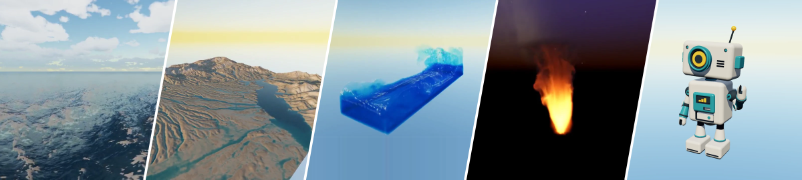

# Cubey

Cubey is a personal graphics and simulation workshop built with C++20 and Vulkan.
Focused projects explore rendering, fluids, procedural environments, materials,
and authored forms, with a shared foundation that grows from their needs.

[](https://dev.byebyebryan.com/cubey/)

**[Explore the demos → dev.byebyebryan.com/cubey](https://dev.byebyebryan.com/cubey/)**

[Build and run](docs/getting-started.md) · [Project guides](docs/README.md#project-docs) · [Architecture](docs/architecture/README.md) · [Roadmap](docs/roadmap.md)

## Build and run

You need Clang 16+ with C++20 support, CMake 3.25+, Ninja, Git, pkg-config,
OpenSSL and Vulkan development packages, a working Vulkan driver, and
`glslangValidator`. Tests require Python 3.11+. See the
[setup guide](docs/getting-started.md#prerequisites) for distribution packages
and window-backend dependencies.

```sh
cmake --preset dev
cmake --build --preset dev
ctest --preset dev
```

Launch a project, for example:

```sh
./build/dev/projects/ocean/ocean
```

The [build and run guide](docs/getting-started.md) covers sample assets,
configuration, controls, headless PNG/MP4 capture, and focused validation.
Native projects own their scenes and simulation; the shared foundation supplies
Vulkan resources, rendering, assets, host/windowing, and capture.

## Repository

| Location | Contents |
| --- | --- |
| [`projects/`](docs/README.md#project-docs) | Runnable projects and their technical guides. |
| [`include/cubey/`](include/cubey), [`src/cubey/`](src/cubey) | Public contracts and shared implementation. |
| [`examples/`](examples) | Small foundation examples. |
| [`studies/`](studies/README.md) | Retained experiments and paused studies. |
| [`site/`](site/README.md) | Presentation site, selected media, credits, and Pages publishing. |
| [`tools/`](tools/README.md) | Repository checks and the local result-report browser. |
| [`docs/`](docs/README.md) | Setup, design, architecture, evidence, and history. |

Build the presentation site independently with `npm ci` and `npm run verify`
from `site/`. It uses tracked captures and needs no native executable or GPU;
see the [site guide](site/README.md) for media preparation and publishing.

Active development lives on `main`. The original OpenGL shader playground is
preserved on `legacy`. See the [design](docs/DESIGN.md) and
[changelog](CHANGELOG.md) for repository context and implementation history.

## License

Cubey source and original project media use the [MIT License](LICENSE).
Imported assets retain their own licenses and attribution, listed in the
[site media guide](site/media/README.md) and [public credits](https://dev.byebyebryan.com/cubey/credits/).
The [retained README gallery package](docs/media/showcase/README.md) preserves
its original capture recipes and the Damaged Helmet media-only CC-BY-NC-4.0 exception.
