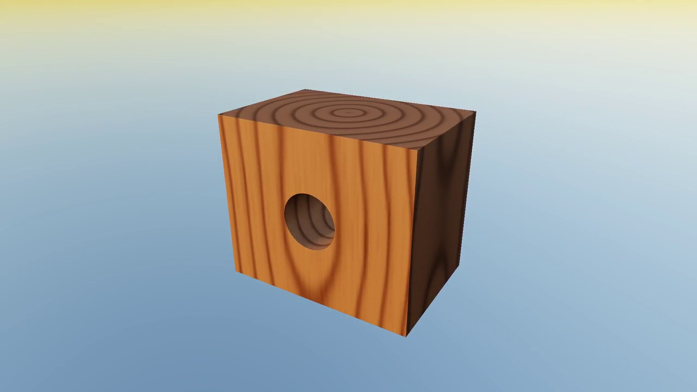

# Material presentation media

Status: retained initial material-presentation package. The current
[material showcase](https://dev.byebyebryan.com/cubey/demos/materials/) presents
twelve materials in both renderers and a four-material cut study. This package
preserves the earlier four-specimen PBR and wood-only SDF stories; the
[media ownership guide](../README.md) explains their separate archival lifetime.

Two independent eight-second stories use the shared material library at the
recorded source revisions below.
The [presentation report](http://starship:8787/reports/5ddba21d5b0e6a6e2ff2a88ccb788cce0a4e2c0527ea8c5bc89b4a0c0bf8d71e/)
contains playable films and an interactive comparison of saved SDF states.
The [plan](../../notes/material-presentation-plan.md) and
[evidence](../../notes/material-presentation-evidence.md) record scope and checks.

| Story | Poster / committed film | Native master |
| --- | --- | --- |
| PBR: contrasting surfaces under one light | [](pbr.mp4) | [1080p](pbr-master-1080p.mp4) |
| SDF: reveal the inside of a solid material | [](sdf.mp4) | [1080p](sdf-master-1080p.mp4) |

The native masters are 1920 × 1080. Gallery copies are Lanczos-downsampled
1280 × 720 H.264 High, yuv420p, 60 FPS, 480 frames, eight seconds and no audio.
Posters are extracted at 6.5 seconds from the corresponding gallery copy.
Encoded cadence is separate from live performance.

[manifest.json](manifest.json) owns the committed file hashes and sizes.
[capture.json](capture.json) retains clean source revisions `1654e825` (PBR) and
`37838ac8` (SDF), exact native/derivative commands, binary/shader/input hashes
and poster timestamps. Each story keeps its own capture identity.
The complete raw qualification stays in `outputs/material-presentation/qualification`
and the immutable report. These are Cubey-generated MIT media.
Use those recorded source revisions and inputs when reproducing this checkpoint;
captures from newer code do not renew its original qualification or byte hashes.

The PBR group selects wood, rust, cloth and bronze. Frosted glass remains in
the library but is less readable in this group. The SDF film previews a tool,
commits one saved subtraction and then reveals the finished bore and end grain.
It does not depict continuous brush sculpting or material simulation.

Reproduce native captures and media metadata with:

```sh
python3 -B projects/pbr_materials/tools/qualify_presentation.py --stage all
```

The `controls` stage uses retained image hashes on the qualified machine. The
native window check runs separately in its own display:

```sh
CUBEY_PRESENTATION_PRIVATE_XVFB=1 xvfb-run -a -s '-screen 0 1280x1024x24' python3 -B projects/pbr_materials/tools/check_presentation_window.py
```

After the scoped test/CLI receipts are present, the presentation exporter is
`projects/pbr_materials/tools/build_presentation_report.py`. It requires an empty
export directory and verifies the native media and control receipts. At this
checkpoint, root-gallery selection and GitHub attachment publication were
separate editorial steps, and this package did not replace the five highlights.
Current public presentation now belongs to the site; this package and its
report retain the original capture and delivery scope.
