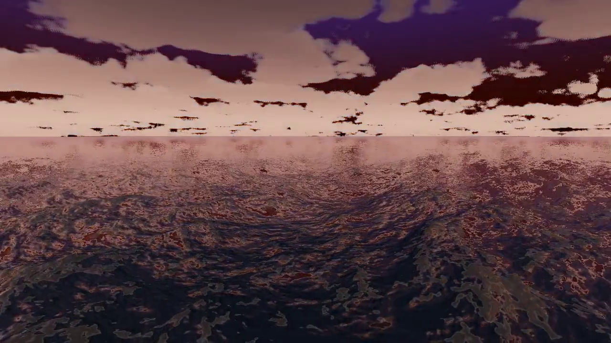
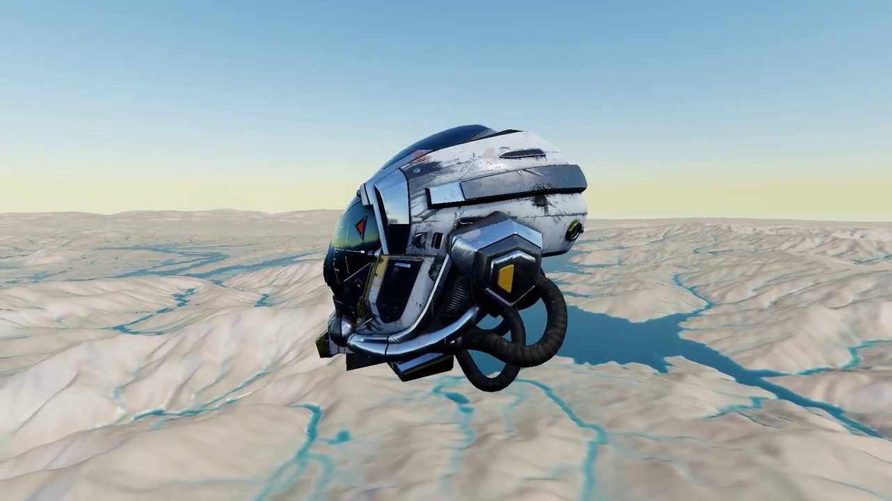
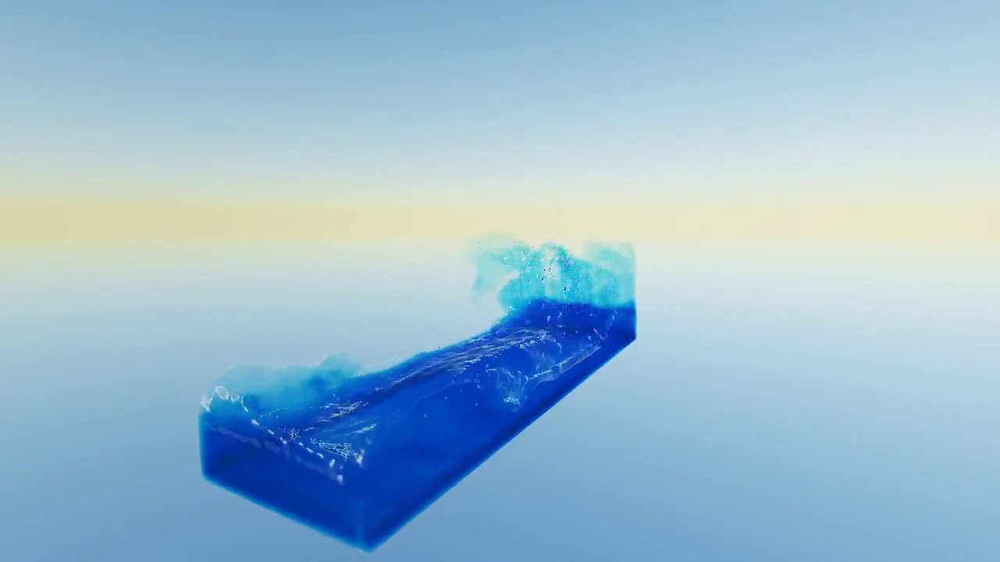
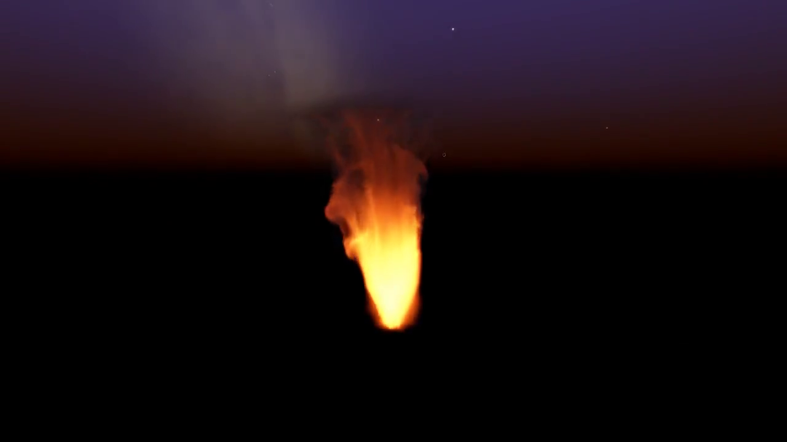
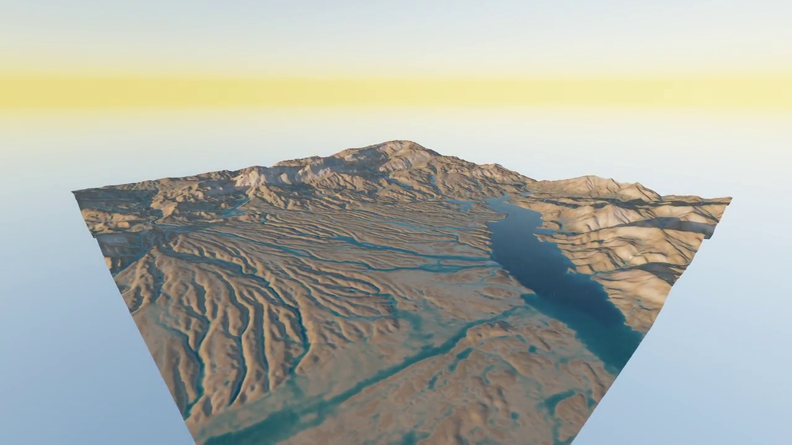

# Cubey showcase media

This directory retains the original five-film README gallery, independently of
GitHub's presentation layer. The current visual collection lives on the
[presentation site](https://dev.byebyebryan.com/cubey/); its
[media ledger](../../../site/media/README.md) records the selected web assets.
These committed MP4s, generated posters, attachment mappings, and the manifest
remain the durable source for the earlier gallery and its capture recipes.

The retained gallery order is Ocean, glTF + Terrain, Water 3D, Fire 3D, and
Terrain Water. Joining valleys sunset is the owner-selected Terrain Water cut. Each poster
is extracted from its corresponding committed MP4; click one to open the clip:

| Highlight | Poster / committed MP4 |
| --- | --- |
| Ocean |  |
| glTF + Terrain |  |
| Water 3D |  |
| Fire 3D |  |
| Terrain Water |  |

Terrain Water's [native 1080p master](fluid-25d-master-1080p.mp4) shows streams collecting
into a lake under an independent sunset clock. The gallery copy is a Lanczos
downsample to 720p/60 CRF 24, not a native 720p capture. The formed-lake poster
comes from six seconds into that copy. Its [complete V2 recipe](fluid-25d-recipe.json)
records clean-source capture, all 72 exact native states, animated endpoint holds,
independent clocks and provenance. Encoded 60 FPS is not live solver performance.
Ocean, Water 3D, Fire 3D and Terrain Water's media/attachment receipts are unchanged by
the glTF promotion.

The owner-selected **glTF A / original mountain / saved water / face-on solar arc**
replaces the interim fixed-morning cut. It starts front-on, eases through 45°,
and advances from afternoon through sunset into early night (14:00→19:30), using
shared automatic exposure. Point stars are off for this capture only.
Its [native 1080p master](gltf-terrain-master-1080p.mp4)
and [recipe](gltf-terrain-recipe.json) retain the clean source revision, exact
commands, frozen inputs and all-480-decoded-frame parity with an independent repeat.
The gallery is a Lanczos 720p/60 CRF 24 derivative; the poster is its four-second
frame. Water is one held 12h SynxFlow storm state with render-only surface cues,
not live hydrology or a lake-formation timelapse. No solver runs in the consumer.
The [legacy glTF recipe](gltf-terrain-legacy-v1-recipe.json) describes the previous
media revision, not hashes of current paths. The old video/poster remain
recoverable from that Git revision, and its original attachment is unchanged.
The interim morning cut also retains its exact
[recipe](gltf-terrain-morning-v1-recipe.json) and
[publication receipt](gltf-terrain-morning-v1-publication.json). Historical
hashes describe those earlier revisions, not the current paths.

The [36-second Mountain rain-off film](fluid-25d-story.mp4) and
[V1 recipe](fluid-25d-legacy-v1-recipe.json) are retained legacy studies. They
describe a different site and rain schedule, not the new highlight. The superseded
Mountain eight-second highlight remains in Git history and the earlier review
report; its V1 recipe retains the original file hashes, not current-file claims.

The highlights are silent, fast-start H.264 High publications at 1280x720 and
exactly 60 FPS. `manifest.json` records their byte hashes, poster timestamps,
capture recipes, source revisions, capture-time dirty-diff provenance,
attachment URLs, and licensing.

Terrain Water's and glTF's approved CRF 20 / 1080p masters are committed alongside their
gallery derivatives. Raw native encoder files, optional field archives, comparisons and
diagnostic media remain ignored editing evidence under `outputs/showcase/`.

## GitHub attachment publication

The original four MP4s were uploaded through GitHub's Markdown attachment
flow and anchored by closed [issue #1](https://github.com/byebyebryan/cubey/issues/1)
at source commit `e21fdd86ba83049d0d187caf3973b1124163e576`. The same mapping
is recorded in `manifest.json`. GitHub serves those attachments to the native
players. The original dry-terrain glTF URL is historical now: it does not serve
the current face-on solar film. The interim fixed-morning A cut was published
from media package commit `023af0be` in its own
[provenance comment](https://github.com/byebyebryan/cubey/issues/1#issuecomment-6205165357).
Its [historical publication receipt](gltf-terrain-morning-v1-publication.json)
is retained. The current [publication receipt](gltf-terrain-publication.json)
records the solar film's separate native-player URL and byte-identical anonymous
download, without changing the earlier comments or attachments.

Terrain Water's exact gallery MP4 was added in a separate
[provenance comment](https://github.com/byebyebryan/cubey/issues/1#issuecomment-6201178145)
on that same closed issue, from media package commit `a53316d9`.
The [publication receipt](fluid-25d-publication.json) records the returned URL,
verified downloaded bytes and unchanged capture recipe. The original four
attachment mappings and issue body were not replaced.

| Highlight | Native player attachment | Committed MP4 | Poster fallback |
| --- | --- | --- | --- |
| Ocean | https://github.com/user-attachments/assets/dc923c55-1061-402f-92ad-09b7da2e7208 | [MP4](ocean.mp4) | [Poster](ocean.png) |
| glTF + Terrain | https://github.com/user-attachments/assets/961c41fe-1bdf-4c0d-a936-1c7fad251f2f | [MP4](gltf-terrain.mp4) | [Poster](gltf-terrain.png) |
| Water 3D | https://github.com/user-attachments/assets/d1267204-7857-40d8-a259-4205605a5a75 | [MP4](water-3d.mp4) | [Poster](water-3d.png) |
| Fire 3D | https://github.com/user-attachments/assets/50052e2e-21f0-46fe-be94-9d8a93a657d0 | [MP4](fire-3d.mp4) | [Poster](fire-3d.png) |
| Terrain Water | https://github.com/user-attachments/assets/453158a4-156c-4031-85ec-f6481780ea08 | [MP4](fluid-25d.mp4) | [Poster](fluid-25d.png) |

Cubey source and the Ocean, Water 3D, Fire 3D, and Terrain Water generated media are MIT
licensed. The glTF + Terrain gallery/native-master MP4s and poster incorporate the Khronos Damaged
Helmet asset and are a media-only `CC-BY-NC-4.0` exception. They must be
attributed to ctxwing (2018 rebuild/conversion) and theblueturtle_ (2016
earlier model); see the upstream
[Damaged Helmet source](https://github.com/KhronosGroup/glTF-Sample-Assets/tree/main/Models/DamagedHelmet).
This exception does not relicense Cubey source, and the glTF media is not
permissively reusable.
