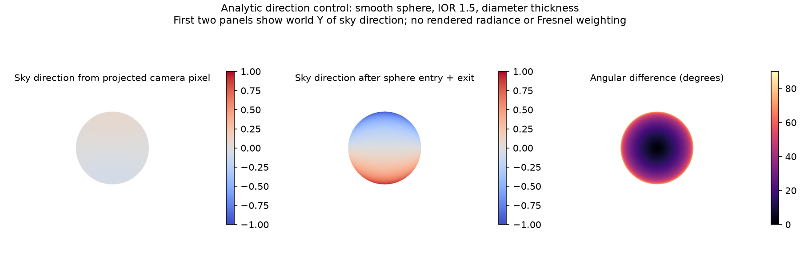

# Forward glass transmission: research and proposed next pass

Research checkpoint: 2026-11-07, source `87b7f61560205de9e1f1b061024234e12ac357ba`
in `cubey-raytracing-first-pass`. This records investigation and a proposal;
the renderer changes below are pending. The completed RT workshop remains the
baseline. No GPU shader A/B was performed in this research pass.

The strongest explanation for the glass mismatch is the forward radiance lookup.
It usually samples the camera image at the projected volume exit, including when
that image contains sky. The tracers resolve the environment along the bent exit
direction. Our existing forward helper can already calculate that direction for
the workshop's spheres. The proposed first pass is to expose environment
transmission explicitly, prove the improvement, and qualify it for the matched
workshop. Local scene refraction is a separate extension.

## What the current implementation actually does

The relevant source is
[`forward_pbr.frag`](../../shaders/cubey/forward_pbr/forward_pbr.frag):

- `cubey_pbr_volume_transmission_ray` (line 223) refracts at entry, estimates an
  exit position and curved exit normal, and calculates an outgoing direction.
- `cubey_pbr_transmission_radiance_at_lod` (line 190) samples the same-frame color
  pyramid and the environment. Its blend weight depends on viewport edges;
  it does not test a refracted ray against scene depth or classify sky.
- The main transmission branch (line 816) projects the exit position into the
  camera image. The outgoing direction is used only by the environment fallback.
  Beer attenuation and a direct transmitted-light term are applied separately.
- Dispersion uses four wavelength-dependent volume rays through the same lookup.

The [forward graph](../../src/cubey/engine/forward_pbr_renderer_3d_graph.cpp)
renders opaque geometry and sky, optionally composites clouds, then copies the
result and ordinary alpha into the isolated refraction source. Transmissive
objects are excluded from that source. The source is already linear HDR;
environment intensity and display exposure must not be applied to it again.
The current pyramid supplies radiance, not a depth/visibility query.

Thickness is already diameter-matched here: gallery spheres have radius .075 m
and forward thickness .15; isolated spheres have radius .25 m and thickness .5.
This is not evidence of a bad material thickness setting.

## Independent geometry and routing control

For an ideal sphere of radius R, entry normal N and internal unit direction T,
the helper computes `d = 2R * -dot(N,T)`. The actual second intersection has this
same distance. Its exit-normal expression is proportional to the inward exit
normal, which is the appropriate orientation for inside-to-air `refract`.
Thus the helper matches the ideal sphere's first transmitted path when thickness
is the diameter, normals describe that sphere, and model scale is identity.
This claim does not extend to arbitrary meshes, shading-normal perturbations,
nonuniform transforms or internal reflection chains.

The [CPU oracle](../evidence/forward-transmission-research-2026-11/sphere_routing_oracle.py)
compares the helper equations with quadratic sphere intersection and an
independent tangent-form Snell calculation. It checks twelve cases: three
specimen positions at IOR 1, 1.33, 1.5 and 2.5, at 1920×1080 pixel centers.
Across these cases, maximum exit/path error is below 3.6e-13 m and exit-direction
vector error below 2.1e-12. IOR 1 returns coincident lookup directions within
numerical precision. This executes double-precision CPU equations, not GLSL.

For IOR 1.5, the camera direction at the projected exit differs substantially
from the actual outgoing direction:

| Smooth-sphere control | Hit pixels | Mean angle | p95 angle | Pixels fully selecting screen source |
| --- | ---: | ---: | ---: | ---: |
| Gallery glass position | 41,858 | 34.11° | 69.07° | 100% |
| Gallery frosted position | 46,274 | 34.32° | 69.39° | 100% |
| Isolated sphere | 320,856 | 31.19° | 63.53° | 100% |

The frosted-position row evaluates smooth geometry at that position; it is not
a rough-transmission simulation. These are unweighted direction errors, not
image-error or energy measurements. Near-silhouette Fresnel weighting matters.



The two left panels show the vertical component of the sky direction. The
camera-image lookup has a small upright variation; the sphere exit ray has a
much stronger inverted variation. This explains a mechanism capable of causing
the observed horizon difference, but a GPU A/B must establish its contribution
to the actual rendered image.

## What established renderers suggest

| Primary reference, pinned source | Relevant behavior | Implication for Cubey |
| --- | --- | --- |
| [Filament refraction implementation](https://github.com/google/filament/blob/e8669b688a9381beb4f7470df828e1932d78efa6/shaders/src/surface_light_indirect.fs#L482) and [mode documentation](https://google.github.io/filament/main/materials.html#materialdefinitions/blendingandtransparency:refractionmode) | Separate environment and screen-space modes; solid-sphere exit construction closely matches ours | Environment transmission is an established raster approach for object viewers |
| [Khronos Sample Renderer](https://github.com/KhronosGroup/glTF-Sample-Renderer/blob/93d0a94da6728ba36090f2526f212e11c26183aa/source/Renderer/shaders/ibl.glsl#L59) | Projects an estimated exit into a transmission framebuffer and filters it by roughness | Useful compatibility reference; this approximation alone does not validate distant-sky optics |
| [HDRP screen-space refraction](https://github.com/Unity-Technologies/Graphics/blob/0efc28ea742b1966b9dd9cc4489e58b986a13faf/Packages/com.unity.render-pipelines.high-definition/Runtime/Material/Lit/Lit.hlsl#L1822) | Uses an exit ray, proxy raycast, depth handling, edge weights and lighting hierarchy | A useful local-scene route needs more than a viewport-in-bounds test |
| [glTF volume specification](https://github.com/KhronosGroup/glTF/blob/9ec408bd03f6c622a026a8989d24257a83311835/extensions/2.0/Khronos/KHR_materials_volume/README.md#thickness-texture) | Raster thickness is a lossy mesh-space estimate; ray tracers use actual distance; attenuation distance is world space | Preserve shared material semantics while allowing different transport implementations |

Filament's guide describes a sphere radius convention that does not match a
literal reading of its `d = thickness * -NoR` implementation. The derivation
above and Cubey's actual diameter settings govern our control; copying a prose
thickness convention would introduce ambiguity.

## Proposed implementation contract

Add an explicit renderer-level transmission-source choice, conceptually
`screen-with-environment-fallback` and `environment`. Exact API/config spelling
is to be settled in the implementation review.

The existing mode remains the default for existing consumers. The new choice
belongs to `ForwardPbrRenderer3DSettings` and workshop view configuration, not
the canonical material recipes or glTF extension data. It must save/reload with
the view and appear in capture metadata. Both ordinary and dispersed volume
paths must honor it. Thin surfaces retain their straight-through direction;
a sphere exit must not be invented for zero thickness.

Environment mode uses the existing estimated exit direction and shared
environment radiance. It keeps the current material, Fresnel, attenuation,
direct-light, layering and display calculations for the initial A/B. This
isolates the lookup change. It deliberately excludes neighboring scene objects,
matching the workshop's environment-comparison contract. It does not promise
correct optics for a dragon, box or arbitrary closed mesh.

Start with the already bound current/previous prefiltered cubes, which preserve
the shared probe transition and require no new resource lifetime contract. At
roughness zero the atmosphere prefilter copies raw sky radiance; freeze and
settle the probe for the first controls. RT instead binds raw sky radiance, so
probe resolution, interpolation and transition differences must still be
measured. A new raw-radiance binding is justified only if those controls show
the existing resources prevent a meaningful comparison.

## Stages and acceptance

| Stage | Deliverable | Gate before proceeding |
| --- | --- | --- |
| F0: isolate the cause | Diagnostic source selection and GPU exit-direction/path observations; current versus environment lookup on the same sphere | GPU directions agree with the CPU oracle away from a documented silhouette/mesh band; IOR 1 is the null control; horizon orientation follows the correct exit direction |
| F1: workshop integration | Typed source setting, save/reload, explicit comparison presets and accurate report labels | Existing consumers retain the old choice; all twelve recipes keep their identities; clear-glass results explain the material difference without tuning assets |
| F2: qualify and deliver | Component evidence, matched stills/orbit/dawn/dusk captures, retention and cost results | New route passes optical, resource-lifetime and existing consumer checks; remaining roughness/energy differences are identified and disclosed |

F0 begins with a smooth, neutral diagnostic sphere, IOR 1/1.33/1.5/2.5, then
the unchanged tinted recipe. Use both a directional gradient/latitude pattern
and the shared clear atmosphere. Record every diagnostic override separately
from recipe identity. Measure exit point, direction and Beer length independently
of final color; do not use agreement between our two tracers as the oracle.

For an initial GPU gate, target p99 exit-direction error below .1° and Beer
length error below .5% of diameter outside a two-pixel silhouette band, relative
to the ideal sphere control. Report full-image maxima and excluded coverage.
These are proposed thresholds: if mesh/interpolation error prevents them,
measure and explain the error before revising the gate. No whole-image RT pixel
match is required, because the current renderers have different Fresnel,
internal-path and filtering models.

F1 may select the new route explicitly in the comparison presets after F0
passes. It must keep legacy captures reproducible. First retain the existing
render graph and pyramid allocation; skipping unused pyramid work is a later,
separately measured optimization, not a dependency of the optical proof.

F2 retains glTF transmission, roughness, thin-wall/volume, order, attenuation,
IOR and dispersion coverage, plus opaque/non-transmission images. Run existing
forward depth-reuse and multi-frame synchronization checks, resize/environment
switch checks, and save/reload checks. Measure incremental forward GPU time and
memory against matched old-mode captures. Retain the original report and create
a separately identified candidate; do not overwrite accepted media.

## Shared atmosphere and remaining differences

The shared lighting foundation already supplies the necessary resources. The
visible workshop sky uses `SkyOnlyNoGroundOcclusion`; its lighting/reflection
probe uses `Ground`. That lower hemisphere is an environment convention, not
a scene ground plane. Both must be recorded; changing one to improve a
screenshot would confound the source-selection experiment.

Keep sun energy, environment rotation/intensity, current/previous probe state
and HDR exposure contracts explicit. RT's rough-glass solar sampling and raw
sky lookup differ from forward's direct BTDF and filtered probe lookup. Any
remaining highlight/brightness mismatch needs a component audit, especially
for second-interface Fresnel and internal reflection contributions.

Frosted glass remains a separate quality topic: a GGX reflection-prefilter LOD
or a spatial color-pyramid blur is not an integrated rough dielectric BTDF.
The pyramid also suppresses isolated bright samples in its first downsample.
Correcting the central ray cannot establish rough-transmission energy parity.
Use constant-radiance and directional-environment controls before proposing
new roughness filtering or a transmission-specific prefilter.

The proposed pass stays on clear atmosphere. Clouds already enter forward's
screen source, but RT cloud transport is deferred; distant cloud probes and
finite cloud segments need their own comparison contract. Diffuse GI is not
required to establish the glass direction or sell the refraction effect.

## Later local-scene extension

If refracting neighboring objects becomes a goal, add a separately qualified
screen-space route from the estimated exit along the outgoing direction,
with depth/proxy validity, misses and confidence-based environment fallback.
Checking that the current projected UV contains opaque depth is insufficient:
it still does not establish that the outgoing ray reaches that object.

Depth must correspond to the same pre-transmission source generation. Current
source color also contains ordinary alpha, whose depth may not describe those
layers, and rough mips can mix sky and objects. A depth or validity export needs
an explicit alpha policy, per-frame ownership and render-graph transitions;
it must preserve the existing persistent-depth reuse fix. Offscreen, occluded,
stacked and nested transparent surfaces remain limitations to demonstrate.

Use a separate small sphere/card proof under the open atmosphere, without a
ground plane. Backface depth, arbitrary-mesh proxy improvements, hybrid RT
transmission, GI and caustics are later decisions. They are not prerequisites
for this environment workshop correction.

## Evidence and reproduction

- [Inspected source identities](../evidence/forward-transmission-research-2026-11/inspection.json).
- [Pinned primary sources and SHA256s](../evidence/forward-transmission-research-2026-11/sources.json).
- [All twelve numerical cases](../evidence/forward-transmission-research-2026-11/sphere-routing.json).
- [CPU oracle and plot generator](../evidence/forward-transmission-research-2026-11/sphere_routing_oracle.py).

From this worktree, reproduce the CPU control with:

```sh
rtk proxy uv run --with numpy --with matplotlib python docs/evidence/forward-transmission-research-2026-11/sphere_routing_oracle.py
```

The script asserts 1e-9 m position/path and 1e-8 direction-vector error bounds,
and a 2e-6° IOR-1 lookup-direction bound. It regenerates only its numerical and
plot artifacts. GPU A/B results, renderer implementation and performance
qualification remain future work.
