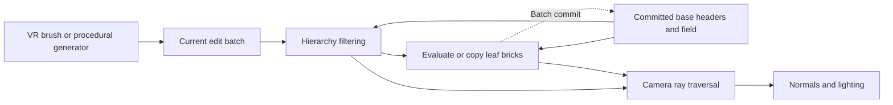
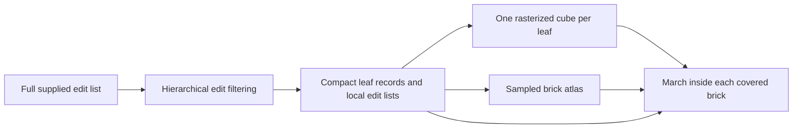

# projectR architecture and source review

Date: 2026-10-21

projectR is a Unity VR sculpting experiment built around constructive solid
geometry and a GPU distance-field cache. Its later renderer traces a hierarchy
of small sampled bricks rather than evaluating every sculpting operation for
every camera ray. The useful unit to revive is this edit-to-field-to-image
pipeline, with the procedural scene providing an independent content source.

This review describes pinned source and serialized scene settings. Unity was
not launched, so performance, appearance and compatibility with a current
editor remain unqualified. The [Cubey exploration record](sdf-projectr-port-exploration.md)
holds proposed next experiments; this document explains the original system.
The [development history](projectr-development-history.md) preserves the
experiments, motivations and reported results from the original commit bodies.

## Branches and evolution

The history runs from December 2017 to April 2018 and contains two substantial
generations. Features from one generation should not be attributed to the
other without checking their implementation.

| Source snapshot | Role |
| --- | --- |
| `marching_cubes_mesher`, `fbaf9ebb6059b3cdf94a305d3e567a02abe3b6d6`, 2018-01-16 | Earlier chunked distance-field editor. Compute passes extract vertices and triangles, read them back and create Unity meshes. It has modification jobs, previews and undo/redo methods. |
| `master`, `e2b80796d8f2f9478965a552342bf66fab0e4114`, 2018-03-22 | Brick engine with a renderer rollback. It draws an indirect cube instance per active leaf brick and marches within each brick. Unity 2018.1.0b10. |
| `develop`, `6a7c5f9a8a6d58ad5d07850b1b625b399385a2f0`, 2018-04-02 | Later single-workspace-cube renderer with hierarchy traversal, hard-shadow code, diagnostics and mouse orbit. Unity 2018.1.0b12. Most VR editing statements in `MainController.Update` are commented out. |

The earlier generation is also retained under `Archive/MarchingCubes` in the
later tree. The late brick renderer does not render the meshes extracted by
that generation. The history's OBJ export and undo/redo work therefore do not
establish those capabilities in the later brick pipeline.

The later renderer is a Unity built-in forward pass targeting D3D11 and shader
model 5. SteamVR/Vive input and volumetric line previews belong to its host and
interaction layer, rather than the distance representation.

## Data flow

`Workspace` holds the edit batch and GPU resources. `BrickEngine` orchestrates
construction and drawing. Compute shaders build the hierarchy and sample the
field. The fragment shader performs visibility and shading. VR input is one
producer of edits; `BrickEngineTest` is another.

## Edits and geometry

An [Edit](https://github.com/byebyebryan/projectR/blob/6a7c5f9a8a6d58ad5d07850b1b625b399385a2f0/Assets/Scripts/BrickEngine/Edit.cs)
is a 48-byte record containing packed operation/primitive/mirror parameters,
inverse translation and rotation, three size parameters and a color integer.
The shader transforms a workspace point into primitive coordinates and
evaluates a distance function there.

[Primitive functions](https://github.com/byebyebryan/projectR/blob/6a7c5f9a8a6d58ad5d07850b1b625b399385a2f0/Assets/Shaders/Distance.hlsl)
cover sphere, box, torus, capsule, cylinder and cone. Size parameters are
primitive-specific: box values are half extents; sphere uses a radius; torus
uses major and tube radii. Some functions include a fixed rounding term.

Distance is negative inside a solid, positive outside, and zero at its surface.
The active editing operations combine the current field `a` with primitive
field `b` in order:

- Fill: `min(a, b)`.
- Remove: `max(a, -b)`.

Subtraction makes order significant: filling a sphere then removing a box is
different from removing the box before the sphere exists.

[Common shader evaluation](https://github.com/byebyebryan/projectR/blob/6a7c5f9a8a6d58ad5d07850b1b625b399385a2f0/Assets/Shaders/BrickEngineCommon.hlsl)
can mirror a primitive across one workspace axis and unions the mirrored copy
with the original. Mirror values select none, X, Y or Z; they are not arbitrary
combinations of three independent axis switches. Evaluation is clipped to a
box with half extent 0.499 inside the unit workspace.

The C# operation enum exposes only fill and remove. A smooth-min function and
intersection case exist in shader source, but smooth-min is commented out and
intersection's value 4 does not fit the two-bit operation unpacking. They are
not established editing features. Likewise, storing a color in `Edit` does
not establish a working material or painting system.

## Hierarchy construction

The [builder](https://github.com/byebyebryan/projectR/blob/6a7c5f9a8a6d58ad5d07850b1b625b399385a2f0/Assets/Shaders/BrickEngineBuilder.compute)
reduces work by classifying space and filtering edit lists before sampling:

1. `PreCompute` supplies the root and the current batch's edit indices.
2. Four construction stages process depths 2, 4, 6 and 8. Each workgroup
   examines a 4 by 4 by 4 subdivision, advancing two octree levels at a time.
3. At a cell center, primitive distance is compared with the cell's half
   diagonal. An edit covering the whole cell can replace its state with solid
   or empty. A boundary edit is retained for deeper evaluation. Fully covering
   edits can also discard earlier entries that no longer affect the result.
4. Only cells requiring further subdivision are appended to the next frontier.
   At depth 8, those cells become the sampled leaf bricks.

The hierarchy is implicit in flat Morton-indexed arrays, with fixed offsets
for each level. The CPU `Node` struct is not the live representation used by
these shaders. Active frontier lists are compact, but metadata arrays reserve
space for all possible nodes through depth 8: 19,173,961 entries.

Node headers encode new-edit, overwritten-base, subdivision and filled flags,
plus a brick index. Edit headers pack an eight-bit count and a 24-bit pointer
into the edit-index list. These widths impose limits independent of allocated
buffer sizes.

The builder tests geometry analytically; it does not discover the hierarchy
by first voxelizing the entire workspace. Correct filtering depends on the
distance bounds and ordered operation handling being conservative.

## Brick sampling and incremental batches

The configured [sampling kernel](https://github.com/byebyebryan/projectR/blob/6a7c5f9a8a6d58ad5d07850b1b625b399385a2f0/Assets/Shaders/BrickEngineCompute.compute)
uses an 8 by 8 by 8 workgroup per leaf. It evaluates the surviving edit list
at sample points spanning the leaf's endpoints and writes half-precision
distance values into a 3D texture atlas. Adjacent bricks duplicate endpoint
samples. Shader sampling maps the brick interval between texel centers to
avoid interpolation into unrelated atlas bricks.

At depth 8, a leaf has side length `1 / 256` in workspace units. Eight samples
span seven intervals, so their spacing is `1 / (256 * 7)`, about 0.000558.
This is the finest configured field spacing, not a screen-space resolution
or a guarantee of stable thin features.

The two field/header sets serve as a committed base and a working result.
Each rebuild starts from the committed state, then applies the current batch.
Unchanged bricks can be copied; overwritten cells start from a solid/empty
sentinel; affected bricks evaluate their retained edits. Output bricks receive
indices from the compact leaf list.

When the edit count passes the batch threshold, `Workspace.AddLastEdit` flips
the field/header buffers and clears the current CPU batch. That is intended
to promote the working result into a new base, keeping older operations out
of subsequent analytic evaluation. It is an incremental baking scheme, not
an indefinitely retained editable CSG tree. Construction still traverses the
hierarchy and samples or copies the resulting leaf set on a rebuild.

## Earlier brick engine and per-brick rendering

The first brick engine is a distinct stage between the marching-cubes editor
and the March incremental builder. The January 21
[hybrid snapshot](https://github.com/byebyebryan/projectR/tree/1ef76e3bbd823c1f20130373d9a8d615d9769760)
is useful because it retains the sampled, analytic and hybrid rendering paths
that were later removed from the compatibility renderer.

Its [construction code](https://github.com/byebyebryan/projectR/blob/1ef76e3bbd823c1f20130373d9a8d615d9769760/Assets/Scripts/BrickEngine/BrickEngineTest.cs)
rebuilds from the supplied edit list. Successive filtering passes produce
compact lists of `Node` records containing an explicit center/size, flags,
brick index and local edit-list pointer. With all stages enabled, the root
is split by factors 2, 4, 4 and 4, reaching 128 cells per axis. It uses a
side-length-two root at this snapshot; the later unit-root convention was
introduced separately. Edits still use 80-byte matrix-based records.

The [filter](https://github.com/byebyebryan/projectR/blob/1ef76e3bbd823c1f20130373d9a8d615d9769760/Assets/ComputeShaders/BrickEngineFilter.compute)
passes each region only the relevant subset of its parent's edit indices.
Uniform regions are discarded from the next frontier; boundary regions
continue until leaves. The leaf compute pass evaluates those short lists into
8-cubed bricks. This generation already uses a hierarchy to construct the
field, but it does not retain the later dense header hierarchy for camera-ray
traversal. Its double-buffered node lists are construction frontiers, not
committed and working sculpting fields.

The [renderer](https://github.com/byebyebryan/projectR/blob/1ef76e3bbd823c1f20130373d9a8d615d9769760/Assets/ComputeShaders/BrickEngineRenderer.shader)
draws an indirect cube instance for each leaf. The vertex shader places that
cube using its node record and supplies the brick/edit-list addresses. The
fragment shader starts at the rasterized brick surface, marches within the
brick and discards rays that leave without a hit.

The shader's distance modes preserve an important experiment:

| Mode | Distance used by the fragment shader |
| --- | --- |
| Sampled | Interpolated values from the brick atlas. |
| Analytic | Direct primitive/CSG evaluation through the leaf's filtered edit list. |
| Hybrid | Sampled values while far from the surface, then analytic evaluation when the preceding distance falls below `distance_switch`. |

Normal evaluation can likewise use field differences or direct evaluations of
the local edit list. Diagnostic modes expose local edit count, normals, ray
steps and the balance of sampled versus analytic work. The January commit
bodies connect these modes to jagged corners and intersection lines; they
were deliberate quality/performance comparisons.

The March 9
[compatibility port](https://github.com/byebyebryan/projectR/commit/6a28941959a4349a10f340175fa77c9c97ddc1a4)
then adapted the old cube-per-leaf approach to the new builder's node pointers
and headers. It removed the older diagnostic/sampling choices. This is the
per-brick renderer retained by `master`, not the complete January hybrid
implementation.

Overlapping brick projections can execute multiple fragment marches for one
pixel. The March 9 message explicitly identifies the lack of useful early-Z
culling in that path and proposes a single hierarchy-traversing ray per pixel.
That is the motivation recorded for the subsequent root-volume renderer;
it does not mean the older construction process lacked hierarchical filtering.

## Later rendering and lighting

On `master`, an indirect cube instance represents each leaf brick. Its fragment
shader marches within that brick and discards rays that leave without finding
a surface. Rasterization supplies candidate brick coverage.

On `develop`, [SetRender](https://github.com/byebyebryan/projectR/blob/6a7c5f9a8a6d58ad5d07850b1b625b399385a2f0/Assets/Scripts/BrickEngine/BrickEngine.cs#L266)
draws one workspace cube. Its
[fragment shader](https://github.com/byebyebryan/projectR/blob/6a7c5f9a8a6d58ad5d07850b1b625b399385a2f0/Assets/Shaders/BrickEngineRenderer.cginc)
does the spatial traversal itself:

1. Transform the camera ray into workspace coordinates and intersect the root.
2. Look up hierarchy states at depths 2, 4, 6 and 8. Skip empty regions;
   descend where the node says more detail exists.
3. Resolve the leaf's atlas brick and march using interpolated distance samples.
   The source caps the outer traversal at 256 iterations and the inner loop
   at 32 iterations.
4. Estimate a normal from nearby field samples and transform it to world space.
5. Shade using Unity's primary light, diffuse spherical-harmonic ambient light
   and an added view-dependent rim term. Some modes launch a second traversal
   toward the light for binary hard shadow visibility.

Both renderer versions return color without exporting the implicit surface's
depth. Rasterized proxy depth therefore cannot be treated as surface depth
when integrating other geometry.

The saved engine asset selects `rendering_mode: 4`, which returns the lit result
before the shadow code. Other modes include traversal heatmaps and altered
shadow stepping. Hard shadows exist in source but are bypassed by the saved
configuration. Noise values are calculated, but their assignments to surface
color are commented out. The active ordinary surface color begins as white;
edit color is not resolved into shaded material data. There is no active
multi-bounce GI, soft-shadow or reflection path established by this shader.

## VR editing and desktop inspection

The `master` [controller](https://github.com/byebyebryan/projectR/blob/e2b80796d8f2f9478965a552342bf66fab0e4114/Assets/Scripts/BrickEngine/MainController.cs)
converts the right-hand brush pose into workspace-local inverse transforms.
A temporary last edit provides the cursor preview; it is removed and replaced
on subsequent updates. Trigger release appends another edit to retain the
stamp. The left trigger uses a second tracked point to change primitive size.
This path should not be assumed to implement continuous stroke resampling.

Separate position and rotation snappers quantize the brush pose. Volumetric
line geometry draws primitive outlines. `Grabber` parents the workspace to
one hand for movement, or to a midpoint object for two-handed uniform scaling.
This moves/scales the workspace transform without rebuilding its local field.

On `develop`, most pose, sizing and commit statements in the controller are
commented out, although field construction and drawing remain active.
`MouseOrbitImproved` provides camera orbit and zoom. It is desktop inspection,
not a complete desktop authoring replacement for the tracked brush.

## Procedural scene and presentation

The enabled build scene is `BrickEngineTestScene`. Its serialized settings
enable random edits at 32 per frame, up to a requested 6,400 edits; `addBall`
is disabled. The
[generator](https://github.com/byebyebryan/projectR/blob/6a7c5f9a8a6d58ad5d07850b1b625b399385a2f0/Assets/Scripts/BrickEngine/BrickEngineTest.cs)
places randomly rotated thin boxes on a spherical shell of radius 0.29-0.30.
Box half extents are `(random(0.05, 0.2), 0.001, 0.001)`.

This is the remembered ball of sticks. The separate `AddBall` method creates
spheres and is not the stick generator. On `master`, the stick recipe instead
uses shell radius 0.39-0.40 and half extents `(0.02, 0.002, 0.002)`.

The later long, thin sticks produce dense crossings, gaps and a changing
silhouette as edits are added. Those properties can serve both a visual demo
and a field/traversal stress scene. The source uses Unity's global random state
and edits per frame, so it does not establish a portable seed or replay clock.
The batching defect below also separates requested edit count from the edits
actually represented by the field.

## Resource and update costs

The saved [engine asset](https://github.com/byebyebryan/projectR/blob/6a7c5f9a8a6d58ad5d07850b1b625b399385a2f0/Assets/Objects/Brick%20Engine.asset)
selects 128 bricks per atlas axis, resolution 8, and the eight-sample kernel.
That produces a 1024-cubed atlas with capacity for 2,097,152 bricks. Source
allocation arithmetic gives the following logical storage per workspace:

| Allocation | Approximate size |
| --- | --- |
| Two 1024-cubed RHalf textures | 4 GiB |
| Two node-pointer, two node-header and two edit-header arrays | 439 MiB |
| Two edit-index arrays, each with four entries per possible node | 585 MiB |
| Combined main allocations | 5 GiB |

The main total is exactly 5,368,709,112 bytes before small buffers, allocation
alignment and driver overhead. This is a calculation from declarations, not
measured VRAM residency. The class default of 64 bricks per axis differs from
the saved asset and would reduce the texture pair to 0.5 GiB.

Four hierarchy stages read append counts back to the CPU to choose subsequent
dispatch sizes. The
[helper](https://github.com/byebyebryan/projectR/blob/6a7c5f9a8a6d58ad5d07850b1b625b399385a2f0/Assets/Scripts/UnityUtilities/Compute/ComputeBuffer/ComputeBufferEx.cs)
uses `CopyCount` followed by `GetData`, creating CPU/GPU dependencies. Their
time cost has not been measured. Global buffer/texture factories release
resources on a Unity destruction event; the workspace itself does not provide
fine-grained resource retirement.

## Review findings

The findings below distinguish source behavior and small deterministic models
from a native Unity reproduction. They identify what to resolve or test before
treating the reference as a correctness baseline.

The batching and persistence entry points are
[Workspace.AddLastEdit and Save](https://github.com/byebyebryan/projectR/blob/6a7c5f9a8a6d58ad5d07850b1b625b399385a2f0/Assets/Scripts/BrickEngine/Workspace.cs#L126-L178),
called by the [procedural update loop](https://github.com/byebyebryan/projectR/blob/6a7c5f9a8a6d58ad5d07850b1b625b399385a2f0/Assets/Scripts/BrickEngine/BrickEngineTest.cs#L101-L113).

| Finding | Consequence and evidence |
| --- | --- |
| Batch rollover can discard pending edits | `AddLastEdit` flips buffers and clears the list when the existing count exceeds 252. The generator computes only after adding all 32 frame edits. A call-order model loses edits 225-253 at frame 8: the promoted field contains the previous 224 edits, and only edits 254-256 remain in the new batch. This is a source/control-flow result, not a native visual reproduction. |
| Save omits the committed field and earlier batches | `Save` serializes only `WorkspaceData`, containing the current list and count. After baking, earlier edits have been discarded from that data and the base is GPU-only. A fresh load cannot reconstruct the complete sculpture. Undo/redo method bodies in the brick workspace are commented out. |
| Empty-cell sphere exits can skip neighboring space | Traversal exits a sphere enclosing the empty cube. On a unit cell's centerline, the cube ends at 0.5 while its enclosing sphere ends at about 0.866. Geometry in the adjacent cell at 0.6 can lie in the skipped interval. This geometric counterexample shows the skip is not confined to the classified empty cell. |
| Actual hit depth is absent | The fragment output is `SV_Target` only. Correct mixed-geometry depth and distance-dependent effects require the implicit hit position. |
| Shadow traversal needs its own correctness check | The first shadow-brick loop starts from `uvw0` retained from primary-ray brick entry, although `tap` has advanced to the surface. Review the start position, offsets, transforms and termination before relying on it. The saved mode bypasses this path. |
| Capacity and packed indices lack explicit failure handling | Builder list allocation and brick assignment use counters without an explicit capacity check in the inspected kernels. A 24-bit list pointer cannot address the whole allocated 76,695,844-entry edit-index buffer; count, pointer and atlas limits need separate accounting. |
| Surface convergence is not always established | Exhausting the 32-step inner primary loop falls through toward shading when the last sample remains within the brick. Fixed distance/normal tolerances and step-limit exits need explicit hit/miss handling and tests at grazing angles, inside the volume and on thin features. |
| CPU and GPU edit data can diverge | `UpdateLastEdit` updates the GPU record without replacing the CPU list entry. Its inspected call sites are commented out, but reviving it unchanged would make saved data disagree with the displayed edit. |

The rollover and persistence issues are especially relevant to the procedural
demo: an attractive image would not prove that its recipe had been preserved.
Keeping canonical edits separate from the field cache would make construction,
replay, persistence and debugging much easier to reason about.

## Implications for a revival

The strongest retained ideas are the input-independent edit record, spatial
filtering before sampling, a brick cache shared by primary and secondary rays,
and a procedural scene that exercises fine structure. These also provide a
clear educational sequence: primitive operations, cell classification, sampled
bricks, ray traversal, then lighting.

Before a Cubey port treats the result as a reference, resolve batch commits,
conservative traversal and hit/depth reporting, and choose explicit resource
limits. Preserve small directly evaluated primitive scenes as comparison
fixtures. Lighting, visual presentation and alternate acceleration strategies
can then be compared against a captured, understandable core.
