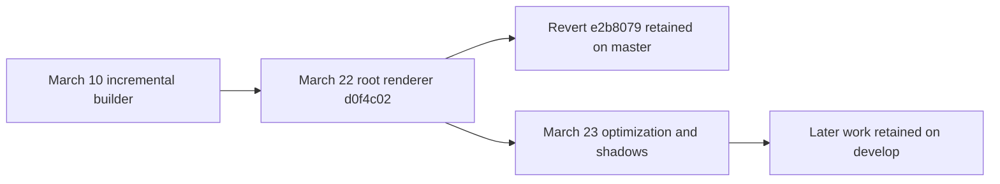

# projectR development history

Date: 2026-10-21

projectR's history records a sequence of experiments in editable distance
fields, rendering and VR interaction. Its central tradeoffs changed over time:
mesh extraction versus direct tracing, sampled speed versus analytic edge
quality, rebuilding edits versus copying cached fields, and per-brick drawing
versus one ray traversing the workspace.

The original commit bodies supply the motivations and contemporaneous results
below. Linked shader/script snapshots establish how the corresponding versions
work. Performance numbers are the author's historical reports, with their
original scope; they are not fresh measurements or a comparable benchmark
series. The [architecture review](projectr-architecture-review.md) explains the
implementations, while [Cubey experiments](sdf-projectr-port-exploration.md)
remain a separate discussion.

## Chunked fields and marching cubes

December 2017 through January 16, 2018 began with a chunked editor that extracted
meshes from distance fields. The messages show rendering, interaction and data
management being developed together:

- [December 19](https://github.com/byebyebryan/projectR/commit/b184970b11a5d3aafc354a57e2ecb13b7d8f857c)
  introduced configurable mesher sampling and Unity LOD groups.
- [December 20](https://github.com/byebyebryan/projectR/commit/f947b91c0a2bfdc5670d89f00143327085cba513)
  explored CPU octree construction and gizmo visualization. By December 22,
  work had started on moving chunk management toward GPU kernels.
- [December 23](https://github.com/byebyebryan/projectR/commit/0810fcdf7c25b17ff540a63a7940564a6cf8dbe8)
  added pooling/queuing for chunk creation and detail mesh extraction.
- [December 29](https://github.com/byebyebryan/projectR/commit/30a22834dfcd0f758c290a25e8bacddafd61818c)
  centralized controller logic to support two-handed operations such as drawing
  a capsule between the hands.

The [January 5 redesign](https://github.com/byebyebryan/projectR/commit/e289b403b0c80af63ce62d513a7a8865214dd09f)
made chunks mostly identifiers, with data managed by the workspace. Modifications
became jobs grouped into job sets, each with a command queue and cancellation
cache. The [next day's message](https://github.com/byebyebryan/projectR/commit/809010eee0815899ffd66d8a8b1dca980db02c65)
describes testing and fixing that framework, imperfect cancellation, and a test
scene that became a visually appealing demo.

Undo/redo brought its own cache problem. The
[January 7 implementation](https://github.com/byebyebryan/projectR/commit/4aecff5a87dbabf2ab4a2ce911c480e2bbc9dea2)
records concern about copying fields while swapping historical states. A
[January 15 correction](https://github.com/byebyebryan/projectR/commit/5a562821f7d76e5e872856361cf5ad8dd0af293b)
addresses corruption of cached fields and changes redo to restart modifications.
There was also a [simple OBJ export test](https://github.com/byebyebryan/projectR/commit/8092c36933baf3400420403c9a45ccadb422643d).
These features belong to this generation; they were not all carried into the
later brick editor.

## Direct tracing and the first brick engine

On [January 17](https://github.com/byebyebryan/projectR/commit/cafe6113c0b4815eeb70bf3aa4f52808d1643b4b),
the existing chunk/workspace framework gained a simple sphere-tracing renderer.
The next three commits then expose a clear optimization sequence.

The [January 18 brute-force brick engine](https://github.com/byebyebryan/projectR/commit/577de07c85b4c90dde758f5e510ef9d035cb7935)
describes 128-cubed bricks containing 8-cubed samples. A filter classified bricks,
a compute pass sampled the leaves, and instanced cubes provided coverage for
fragment raymarching. Every candidate still evaluated the full edit list; the
message reports that more than ten edits already made evaluation very slow.

The [first January 19 improvement](https://github.com/byebyebryan/projectR/commit/673bc1641ce34a42be3d1a6e14badd123476cc49)
gave each brick a shorter edit list. The author reports roughly one or two edits
per brick during sampling, moving the bottleneck back to filtering. The same
message reports about 15 FPS for 100 edits and identifies the next step: shorten
lists progressively over multiple filter passes.

The [second January 19 improvement](https://github.com/byebyebryan/projectR/commit/2bfb7c267291929b1db41fb33fa7924031a2ece6)
does that through octree-style refinement. Each region passes a reduced list
to its children. The message reports filtering becoming fast enough that the
more substantial sampling work was again the main concern.

This is the origin of hierarchical edit pruning in the project. The renderer
still marches individual rasterized bricks; hierarchy in field construction
and hierarchy in camera-ray traversal are separate developments.

## Jagged edges and hybrid distance evaluation

The [January 20 investigation](https://github.com/byebyebryan/projectR/commit/f2c1887cccc38d9a1dbf4a377d164582bdda62c2)
focuses on jagged edges on rotated boxes. Sampling adjustments did not resolve
them. Directly evaluating primitive distances from the local edit list produced
cleaner edges and intersection lines, but was substantially slower.

The message reports about 30 FPS for 128 edits with direct evaluation, versus
over 60 FPS for 8,000 edits using the cached field. Those are reports of the
then-current experiments, not controlled measurements of the final renderer.
The same commit moves normal calculation toward differences of field samples,
with attention to brick borders and avoiding margin cells.

The [January 21 hybrid mode](https://github.com/byebyebryan/projectR/commit/1ef76e3bbd823c1f20130373d9a8d615d9769760)
combines the approaches: use cached distances to approach the surface, then
evaluate the local analytic edit list near it. The message reports improved
edge quality with a noticeable cost and calls for more tuning.

The [shader at that snapshot](https://github.com/byebyebryan/projectR/blob/1ef76e3bbd823c1f20130373d9a8d615d9769760/Assets/ComputeShaders/BrickEngineRenderer.shader)
retains sampled, analytic and hybrid distance modes, plus different normal
evaluation paths and diagnostics. This is an existing experiment to preserve
in the history, even though the later compatibility renderer omits it. The
same commit also drafted a brick-based marching-cubes kernel; its message
explicitly says it compiled but had not been tested.

## Making the brick engine usable in VR

During late January and February, work also developed the authoring shell:

- [January 23](https://github.com/byebyebryan/projectR/commit/55e13bd38a63ffbee12f8f3462bb6a01af5b798c)
  changed atlas packing from Morton order to explicit X/Y/Z indexing for
  arbitrary pool sizes, and established a unit workspace capped at half extent
  0.499. Spatial node indexing and atlas packing should not be conflated.
- [January 25](https://github.com/byebyebryan/projectR/commit/6361e9574e681cc62577c5358cf1fff5a285c9f6)
  added VR plugins, a brick-engine controller and workspace management. Its
  message already calls out incremental editing as an unresolved need.
- [January 27](https://github.com/byebyebryan/projectR/commit/2aaeb42f2591e7f4b51d96acc73268807c6c54c5)
  reduced edit records from 80 to 48 bytes by replacing a matrix with position
  and rotation. The author notes limited practical benefit at small edit counts.
- January 30 added fixed-axis mirroring; February 7 and 9 expanded primitive,
  operation and mirror controls, then position and rotation snapping.
- [February 13](https://github.com/byebyebryan/projectR/commit/635cb065465277436451f7639a5b605301a8c5ed)
  introduced volumetric line previews. The message celebrates finally seeing
  the preview shape, then identifies GameObject churn and garbage collection
  while updating it every frame.
- [February 20](https://github.com/byebyebryan/projectR/commit/bbc178ae40b89e91a1e9ce3bd7c69b781a74f04c)
  added simple save/load and upgraded Unity to the 2018.1 beta.

This strand explains why the project grew into a tool: spatial control,
preview, history, persistence and resource management each introduced work
beyond producing the rendered surface.

## Incremental construction and the cost of copying fields

The representation rewrite overlaps the interaction work. Its
[January 30 starting point](https://github.com/byebyebryan/projectR/commit/c90f3b80fc50e37d3fdacf6ff128d7033e3ea0be)
is explicitly labeled very unfinished. February builder commits continue that
work. On [March 7](https://github.com/byebyebryan/projectR/commit/ff7a093cbdae25fad5ff240633bdc0c9618d3199),
the message says much of the octree construction was implemented, but the
renderer had not yet been adapted and correctness remained uncertain.

The [March 9 integration](https://github.com/byebyebryan/projectR/commit/6a28941959a4349a10f340175fa77c9c97ddc1a4)
opens with "Success!" at rendering a primitive through the new builder. It
also lists the limits: the old renderer was adapted rather than replaced,
occluded bricks still incurred fragment marching, and incremental construction
had only been tried from an empty previous state. Its proposed rendering
direction was one hierarchy-traversing ray per pixel.

The [March 10 message](https://github.com/byebyebryan/projectR/commit/906cb159c292e276bfc3994f183f5a252a51004b)
opens with "It's complicated..." and contains the most detailed design review:

- The overwrite/inheritance logic appeared to hold up in partial testing.
- The field used 256-cubed leaf resolution with 8-cubed samples per leaf.
  The atlas used 128-cubed bricks, and half precision reduced its footprint.
- The ball-of-match-sticks test was added. Rendering alone was reported around
  200 FPS in that experiment; construction with 16,000 small edits fell below
  30 FPS. These describe separate rendering/construction conditions.
- Two roughly 2 GiB pools and rapid pool occupancy growth were a major concern.
  The author attributed the poor incremental scaling to copying previous field
  data and questioned the premise of retaining a full previous pool.

That last point is a diagnosis recorded in the message, not a bandwidth
measurement. The later kernel copies or reevaluates active leaf bricks;
allocation of a large atlas does not itself prove a full-atlas copy each frame.

Two alternatives were already proposed in that commit:

1. Update a single field in place, with harder brick allocation/reclamation and
   unresolved undo/redo implications.
2. Keep previous filtered edit lists instead of previous sampled distances,
   relying on small local lists and truncation by fully covering operations.

The final branch still contains the paired-field design. The alternatives
remain original proposals, rather than implemented solutions established by
the final source.

## The root-volume renderer fork

The [March 22 renderer](https://github.com/byebyebryan/projectR/commit/d0f4c025803052754f29a5902a03b50b323103a7)
replaces cube-per-leaf drawing with tracing from the workspace bounds. Its
message reports the instanced renderer at roughly 30 FPS in a 256-cubed stick
test without compute, while the first root renderer did not reach 90 FPS even
at the stated 64-cubed resolution. Near-plane clipping of the root cube was
also left for later work. These reports have different scene/settings context
from March 10 and should not be combined into a single performance curve.

The branch topology is important:

`master` ends at the [revert](https://github.com/byebyebryan/projectR/commit/e2b80796d8f2f9478965a552342bf66fab0e4114).
`develop` continues from `d0f4c02`; it does not descend from that revert. The
new renderer's continuation and the rollback are sibling lines of development.

On [March 23](https://github.com/byebyebryan/projectR/commit/0b8e3a1223d49bf2342bb759c4ed491dddebf831),
the author reports a large improvement from rearranging traversal loops,
reaching 8 ms for primary rays at the stated 256-cubed resolution. The same
message says adding simple shadow rays broke those primary-ray improvements.
The 8 ms report therefore does not qualify the combined final shader.

## Appearance and inspection experiments

The continuation mixes rendering experiments with presentation improvements:

- [March 23 noise color](https://github.com/byebyebryan/projectR/commit/157c36923b78f629fa6ebd8d43eecaa376cf8890)
  has the short explanation "looks prettier". Its diff enables hue derived
  from noise at the surface position.
- [March 26](https://github.com/byebyebryan/projectR/commit/fbf79ec141947c20d68438c116b96130c84cb8b6)
  handles a camera inside the root volume, fixes removal, adds mouse orbit and
  changes double-buffer flipping. Being inside the workspace is distinct from
  tracing correctly out of the interior of a solid.
- [March 27](https://github.com/byebyebryan/projectR/commit/e886b0c19a0d0423396319d2edfdaefa18bc9580)
  reports a Fresnel term and a crude reflection experiment. The diff adds the
  rim term, leaves the reflection block commented out and disables the earlier
  noise-color assignment. The rim term remains active at the final snapshot;
  the reflected-ray block and earlier noise-color path are dormant.
- [April 2](https://github.com/byebyebryan/projectR/commit/6a7c5f9a8a6d58ad5d07850b1b625b399385a2f0)
  rearranges external packages and adds the Lab renderer for reference plus
  skyboxes.

The final saved engine mode also bypasses hard shadows. A branch tip captures
one chosen experiment configuration; it does not display every effect explored
along the way.

## Reading the implementations alongside the journey

| Question | Starting point |
| --- | --- |
| How did the earlier editable mesh system work? | `fbaf9ebb`, retained as `marching_cubes_mesher`, plus `Archive/MarchingCubes` in the later tree. |
| How did local edit pruning and sampled/analytic/hybrid tracing work? | `1ef76e3`, especially the old `Assets/ComputeShaders` filter and renderer. See the [earlier brick walkthrough](projectr-architecture-review.md#earlier-brick-engine-and-per-brick-rendering). |
| How was the old per-brick renderer adapted to the new builder? | `6a28941`, followed by `906cb15`; the restored per-brick path remains on `master` at `e2b8079`. |
| How did the single root-volume tracer evolve? | `d0f4c02` followed by the March 23-27 commits on the path to `develop`. |
| Which feature is present and selected at the final snapshot? | Read shader control flow together with scene/engine assets at `6a7c5f9`, using the [architecture review](projectr-architecture-review.md). |

The earlier brick renderer deserves its own explanation because it exposes
quality modes, diagnostics and construction choices that a review of the final
branch alone would miss. The commit bodies also preserve the reason for each
change and the doubts that accompanied it, including alternatives left open
when development stopped.
