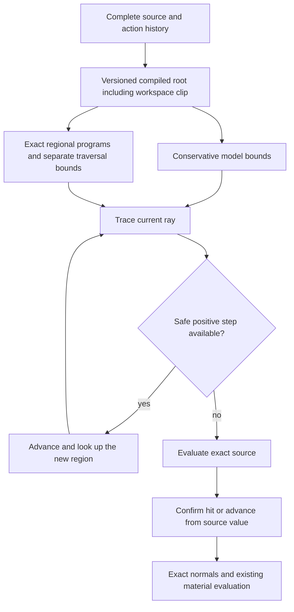

# SDF acceleration research and experiment plan

Date: 2026-10-28. Baseline: `b4b9c85e3a7c35438a7375c249c83228540928e8`.
Status: researched proposal for a bounded implementation loop; no new renderer
implementation, adoption or GPU benchmark is part of this search pass.

The subsequent E0–E3 loop is complete; see the
[measured results](sdf-acceleration-loop-results.md). The proposal below is
retained as the original experiment contract, not an instruction to continue
automatically into E4 or E5.

## Recommendation in plain language

Keep the authored CSG and undo history. Try three small changes before choosing
a larger backend: let a proven cached distance take a useful step; reject rays
outside a conservative bound for the current model; and answer queries in empty
regions with a cheap distance bound instead of evaluating their CSG program.
Exact source evaluation still determines intersections, normals and appearance.

Then investigate finer local programs and GPU construction, in that order if
the measured frame workload warrants them. Preserve the sampled default.

The first proposed loop ends with a decision on the small changes, at the
current 64-region resolution. It does not commit us to a GPU allocator, an
adaptive tree, a new modeling representation or a live sculpting editor.

## What the current evidence establishes

The [Guardian investigation](sdf-guardian-investigation.md) measures primary and
shadow tracing as the large costs. Its best diagnostic combination is about
10.13 ms analytic at 320x180, with full-HD candidate performance unmeasured.
Padded analytic replay still spends 60.9% of primary CSG visits on miss rays;
visible-hit programs average 78 instructions, versus 4.9 for Robot. Full-Guardian
region construction/upload takes roughly 421–473 ms in the retained cold runs.

These are distinct problems: expensive per-frame queries, and expensive cache
construction after edits. They need separate gates. The source/material/history
contracts and original geometry fixtures remain the reference.

A source audit identifies three specific gaps:

- `selected_trace.glsl` clamps an already error-bounded sampled step to the
  current brick exit, and returns no step for uniform-cell labels. Whether the
  former clamp is necessary deserves an isolated test; the latter labels need
  a separate construction/error proof before treating them as safe traversal.
- Our region builder/evaluator keeps exact programs throughout space. The pinned
  donor also has a separate far-field constant path that is absent from the
  native Cubey region route. Its isolated first-level test did not qualify a
  complete native hierarchy, allocator or renderer.
- Cubey's hierarchy currently stops at 4/16/64. The paper evaluates a further
  256 level. More refinement is an experiment, not evidence that a dense 256
  allocation or its performance will suit Guardian.

## Research shortlist

The [source ledger](../evidence/sdf-acceleration-research-2026-10/sources.json)
records primary references, inspected sections and availability limits. The
assessments below are Cubey-specific judgments; published speedups are not
predictions for our scene or GPU.

| Approach | What the reference contributes | Decision for Cubey |
| --- | --- | --- |
| [Lipschitz Pruning, 2025](https://wbrbr.org/publications/LipschitzPruning/) | Exact local programs, separate conservative far-field constants, and per-level GPU construction. | Main continuation. The latter two features have not been implemented/qualified in our native path. |
| [Hart's sphere tracing, 1996](https://experts.illinois.edu/en/publications/sphere-tracing-a-geometric-method-for-the-antialiased-ray-tracing/) | A safe step needs a distance lower bound. | Audit the unnecessary-cell-clamp hypothesis; keep bounds distinct from exact field values. |
| [Accelerating Signed Distance Functions, 2025](https://perso.liris.cnrs.fr/eric.galin/Articles/2025-lod.pdf), §§4–5 | Proxy nodes can reduce field-evaluation work; LOD is a separate geometry-changing mechanism. | Contingency. A root bound is simpler first; subtree proxies need additional semantic checks below smooth operators. Exclude LOD and normal warping from this comparison. |
| [Sphere Carving, 2025](https://aparis69.github.io/SphereCarving/index.html) | Builds tight bounds from black-box conservative distance queries. | Later if cheap analytic bounds are too loose. Its release differs from the paper; reported difficult cases and decompositions can take seconds. |
| [Segment Tracing, 2020](https://aparis69.github.io/public_html/projects/galin2020_Segment.html) and [Enhanced Sphere Tracing, 2014](https://diglib.eg.org/items/8ea5fa60-fe2f-4fef-8fd0-3783cb3200f0) | Reduce tracing iterations using local bounds or checked over-relaxation. | After query-cost reductions, if iteration tails become dominant. Do not substitute an unchecked step multiplier or a screen-space hit fallback. |
| [MPR, 2020](https://www.mattkeeter.com/research/mpr/) and [Fidget](https://github.com/mkeeter/fidget) | Interval/tape reduction and expression-evaluation infrastructure. | Larger representation/compiler alternative if the capability goal broadens. Not a drop-in speed fix for our existing primitive program. |
| [Generalized Lipschitz Tracing, 2024 online / 2025 issue](https://onlinelibrary.wiley.com/doi/10.1111/cgf.15202) | Directional derivative-bound caches while retaining original geometry queries. | Defer. Its fast procedural GPU fitting is approximate and lacks automatic approximation-failure mitigation. |
| [Synchronized tracing, 2023 preprint](https://arxiv.org/abs/2304.09673) | Tile-coherent on-demand pruning for large blobtrees. | Alternative pipeline research, with operator and secondary-ray questions. Not the first modification to the current shared 3D query path. |

Two distinctions matter when using these references. The Lipschitz Pruning
paper explicitly leaves partial updates and sparse adaptive partitioning as
future work; a sparse Cubey extension would be our own implementation. Also,
cheap subtree proxies that preserve a child's zero-set can still change a parent
smooth blend: the parent uses distance values, not just inside/outside signs.

## Fixed contracts

- The complete authored source and atomic logical actions remain authoritative.
  Spatial caches are disposable and associated with one geometry version.
- Source-defined intersections and geometric normals retain the frozen epsilon,
  normal stencil, independent answers, and regular/grazing tolerances. Region
  resolution is an acceleration setting, not a surface-resolution setting.
- Retain grouping, smooth radii, rigid/uniform transforms, cuts and material
  ownership. No reassociation of smooth operators, source simplification, new
  authored content, or distance-only material pruning.
- Every terminal hit is confirmed by exact source evaluation. A positive lower
  bound near zero is not evidence of a hit. Normals use exact values at each
  stencil point; appearance uses the existing full evaluator/qualified shortcut.
- Primary, shadow and optical traces share the same qualified geometry query
  contract. A camera-specific primary-ray optimization cannot silently serve
  as the acceleration structure for secondary rays.
- Keep outside-domain and capacity fallbacks. Exhaustion is never a miss;
  incomplete cache construction never publishes. No new device-feature
  requirement, candidate resource or job is added to the unselected default.

Here “exact” means the original authored function within the qualified numerical
contract, not exact Euclidean distance after CSG or a universal FP32 proof.

## First implementation loop: isolate the cheap changes

### E0 — Normalize the comparison baseline

Create a private, ordinary native rendering control with the already-qualified
padded entry and explicit GPU-local source/region uploads. Use the project's
existing upload/owner services, with a portable staging/device-local path;
do not require the CPU-mappable device-local type used by the diagnostic.
Keep the original diagnostic routes as historical controls.

This control must have no stage-ablation branch in the timed fragment shader.
The previous 10.13 ms figure was a diagnostic measurement; remeasure the
ordinary pipeline rather than promising that exact value. Preserve the sampled
route and accepted scene/preset bytes, verify selected resource allocation and
geometry identity, then freeze this control for subsequent A/B runs.

### E1 — Audit the current hybrid's cell-exit clamp

Question: does an unnecessary clamp account for part of the current hybrid's
weak payoff? Change only the final `min(pointBound, cellExit)` behavior after
establishing that `pointBound` is a global lower bound on distance to the true
source surface at the current point. Preserve its interpolation, R16, source
arithmetic guards and exact-hit fallback. Re-look up the region after a jump.

This is a test of the current error-bound implementation, not permission to
remove arbitrary spatial-domain clamps. Local derivative bounds or a program
that is evaluated outside its validity domain do not meet this premise.
Do not start treating existing uniform labels as distances. Their classifier
currently uses its own fixed rounding allowance and needs a separate audit.

Compare unchanged analytic, unchanged hybrid and this one-change hybrid on the
same source, GPU resources and views. Retaining its full field means a frame
win alone would not resolve field memory or rebuild latency.

### E2 — Bound the current model, not only the workspace

Build a conservative root AABB from the compiled snapshot. Begin with analytic
bounds for the seven existing finite primitives and current operators, using an
offset-aware sublevel-set query `Bounds(node, tau)` rather than assuming every
intermediate CSG value is exact Euclidean distance. Include the hit band and
numerical margin in `tau` and padding, and intersect with the padded workspace.

A possible derivation for the current operators is in Appendix B. Unknown or
unqualified cases fall back to the existing workspace bound. A valid empty
source state must remain an explicit empty state. Bounds must update on moves,
smooth-radius changes, undo/redo and new branches, while appearance-only changes
reuse compatible geometry data.

Use this bound solely to restrict the ray interval. Do not infer that a child
CSG branch is irrelevant merely because the query is outside that child's
zero-set bounding box. Exact normals may query outside the root AABB.

Compare root bounds alone, holding region resolution/programs and stepping
unchanged. Count rejected rays and source work saved on hit and miss rays.

### E3 — Add root-field distance bounds to existing regions

Start at axis 64 with the CPU builder as the inspectable reference. At a cell
center `c`, use the final clipped root field `F(c)`, cell radius `R`, and the
qualified arithmetic error allowance `eta`. A conservative cell-wide magnitude
is `b = max(abs(F_hat(c)) - eta - R, 0)` under the stated 1-Lipschitz assumption.
Use a fixed initial far threshold `abs(F_hat(c)) - eta > 2R`, keeping a generous
exact band. This is a root traversal certificate, not an approximate operand
inserted into the CSG tree.

Add explicit cell kinds: exact program, far traversal bound, and full-source
fallback. A zero reference count must not ambiguously mean both far space and
allocation failure. Store sign/domain/version where needed. A far parent's
already-established bound can be inherited unchanged by its children; do not
reuse its center sample as if it belonged to a smaller child.

The current CPU builder's intermediate root value omits the final workspace
clip; its query evaluator adds the clip afterwards. A far certificate must use
that final `max(source, boxDistance)` field. Otherwise a large solid can falsely
certify a cell containing a real clip-face surface as uniformly inside.

The tracer consumes the bound only as a safe advance, then performs a fresh
lookup. Source hit confirmation, normal stencils and materials bypass bound
values. Exact requests in a far cell can fall back to the full source and must
be counted. This route allocates no `Field` or sampled atlas.

Measure far bounds alone and their combination with E2. Keep near-field
programs at the same 64 resolution so finer pruning does not hide the effect.
Do not add a DDA walker in this first trial: it is a separate boundary/progress
algorithm, and the initial far threshold is intended to avoid tiny advances.

### First-loop control matrix and stop

| Control | Root interval | Traversal aid | Exact geometry data |
| --- | --- | --- | --- |
| S0 | Existing sampled behavior | Existing bricks | Existing sampled baseline |
| A64 | Qualified padded workspace | None | Exact regional source, GPU local |
| H64 | Same padded workspace | Current sampled bound with existing clamp | Exact regions plus full field |
| H64-unclamped | Same padded workspace | E1's qualified point bound | Same regions/field as H64 |
| A64-root | E2 root AABB | None | Same exact programs as A64 |
| A64-far | Padded workspace | E3 far bounds | Exact near programs, no field |
| A64-root-far | E2 root AABB | E3 far bounds | Same exact near programs, no field |

These are study identities, not adopted public CLI/API names. Prefer one private
variant selector/manifest over independent user-facing switches. Existing
geometry/history/material formats and source route controls remain intact.

End this loop with a decision report: which aids reduce actual GPU time, what
work remains near surfaces, whether the current field still earns its cost, and
whether the next bottleneck is query cost or construction. Do not automatically
continue into a GPU builder or proxy system.

## Conditional continuation

### E4 — Refine where exact programs remain costly

If E3 leaves a substantial surface-query tail, compare axis 64 with an additional
256 refinement level. First collect active-cell/reference counts and forecast
peak memory. A 16-byte descriptor for every dense 256-cubed cell alone needs
256 MiB, before programs, double buffering and scratch.

Start with the simpler bounded hierarchy if it fits. Subdivide uncertain cells
and retain coarser far certificates where useful; a compact active hierarchy is
a Cubey extension to qualify separately. Fixed current hit/normal tolerances
remain unchanged. Report query-weighted near-field lengths and total GPU time,
not the scene-wide average after far constants dominate the cell count.

### E5 — Build the selected structure on the GPU

Proceed when a structure has demonstrated useful rendering and its CPU build
blocks the edit target. Reproduce the qualified per-level operation before
attempting partial updates: parent programs/certificates, classification,
count/allocation, compact output and explicit completion/overflow state.
Use 32-bit references and existing baseline capabilities. The donor's small
first-level adapter is not qualification of its original allocator/subgroups.

Keep CPU and GPU builders as differential references. Compare decoded programs,
kinds/bounds and query behavior; atomic allocation need not give identical global
offsets. Account for old published, pending, scratch and source allocations.
Only publish a complete cache matching its source version after the required
GPU visibility/completion. A failure retains the previous complete snapshot.

Partial updates require a later dependency/invalidation contract. A primitive's
visible AABB alone does not bound all changes to its distance values or stored
far certificates. Full GPU rebuilds must be measured before claiming incremental
edits or undo are solved by the paper.

### Alternatives if the measured branch disappoints

- Try root/group proxies only with explicit parent-operator and source-value
  contracts. The newer proxy paper is informative, but preserving a child's
  zero-set or Lipschitz property alone does not preserve a smooth parent's
  result. Root traversal bounds are the lower-risk first placement.
- Use Sphere Carving if analytic bounds are too loose and its build cost can be
  amortized; do not assume its published or release timings suit per-edit work.
- Try checked over-relaxation or segment bounds if iteration tails become the
  dominant cost after reducing query work. Keep exact hit acceptance/exhaustion.
- Profile interpreter memory/register costs if source visits fall sharply but
  native timing does not. Gather evidence before committing to JIT/tape migration.
- A pruned sampled-field builder is a separate way to improve S0 editing. It
  retains sampling limitations and does not count as a source-quality solution.

## Measurement, acceptance and rollback

Correctness gates precede timed comparisons. Keep the 32-fixture manifest and
its 155 independent checks/tolerances frozen; extend coverage explicitly rather
than relaxing it. Add controls for bounds crossing several cells, exact requests
in far cells, both signs, accepted hit-band grazing, grid/cell faces, tiny
features/cavities, clipping and inside exits, and all current smooth/group/cut
semantics. Keep the rejected exact-clip inside-exit case as a regression.

Test bound inequalities separately from exact field-value equivalence. Deduct
numerical/storage uncertainty during bound construction; an approximation's
small value cannot pass the source hit test. Independent known zero/hit-band
controls must never be declared safely far. General parameter/FP32 certification
remains separate from the qualified engineering envelope.

Run the existing 20-action semantic publication/undo replay for every new
cache-bearing variant before the first-loop decision. Geometry-version
invalidation, appearance-only reuse, failure/retry and retained history are
correctness gates now. E5 later adds GPU-builder-specific failures and timed
action-completion measurements; it does not defer the undo contract.

Use Robot and Guardian at their fixed preset view plus predetermined side/rear
views, with identical lighting, shadows, sampling and source hashes. Batch camera
queries by view within the harness budget. Compare with the qualified exact
source route, sparse full-source checks and independent fixtures; do not render
the unpruned thousand-leaf reference at full HD just to fill a table. Include
bounded optical inside/interface tests before adopting a shared tracer change.

For selected candidates, use three interleaved repetitions, 180 frames, 30
warmup and 150 completed GPU samples. Keep captures/counters outside timing
runs. Report native ordinary-pipeline whole-scene GPU p95 and ranges. Record
primary/normal/shadow exact queries, hit/miss work, bound lookups/advances, all
fallback reasons, iteration tails and region kinds/program lengths. CSG visits
are not GPU machine instructions. A useful counter change without a timing
benefit is not an adoption pass.

Retain the existing progression guards: 320x180 p95 <=12 ms before 960x540;
960x540 p95 <=50 ms before collecting 1920x1080. No full-HD extrapolation. A
progression pass is permission to measure the next rung, not 60 fps evidence.
The practical targets remain 16.7 ms full-HD frames, 100 ms p95 discrete geometry
edit completion, and 2 GiB peak requested geometry payload with transient overlap
identified. Report actual heaps; this is not a total-process memory guarantee.

Cold construction, steady frames, and action completion are separate receipts.
For E5/action evaluation, time compilation/hashing/build/upload/publication and
first completed GPU frame, including undo/redo, branching, atomic mirrors,
earlier-group/radius edits, appearance-only reuse, injected failure and retry.
Queue-idle completion is not physical display latency or continuous-brush input.

Stop a candidate on correctness failure or exhausted/corrupt output. Preserve
its receipt and restore the exact control; do not remove guards or alter content
to make it win. Stop capacity-infeasible configurations before allocation. Keep
each experiment reviewable in a local checkpoint. No push, default adoption,
public media refresh, new editor, or asynchronous build system is authorized by
this plan alone.

## Proposed implementation ownership

| Responsibility | Project-local touchpoints |
| --- | --- |
| Variant selection, resources, atomic publication | `sdf_config.h`, `sdf_app.cpp`, `sdf_renderer.*` |
| Conservative model/sublevel bounds | A small new project-local helper over compiled `SceneInstruction`/CSG; existing authored compiler remains authoritative |
| Regional certificates and later GPU builder | `sdf_regions.*`, new selected compute kernels; existing owner/upload services |
| Step-bound versus exact-value query paths | `selected_trace.glsl`, `source_trace.glsl`, selected region/query includes |
| Reproducible controls and gates | Existing tracing/Guardian tools, independent fixtures, action/optical validators and evidence |

No generic engine tracing framework or third-party backend integration is needed
for E0–E3. The research pass imports no external implementation code.

## Appendix A — Why a globally safe step may cross a cell

Let the true clipped root field be globally 1-Lipschitz, and let its evaluated
value at `p` have a known absolute error at most `E`. Then
`max(abs(F_hat(p)) - E, 0)` is a distance lower bound to its zero-set. Once this
bound is established at `p`, a single ray advance by it may cross a cell face.
The evaluation and its error proof must be valid at `p`; the next evaluation
must use the new cell. Local-only variation bounds require different handling.

For a center sample, triangle inequality gives, for every `p` in its cell,
`abs(F(p)) >= abs(F(c)) - length(p-c) >= abs(F_hat(c)) - eta - R`.
This yields E3's cell-wide lower bound. It can be discontinuous between cells
because it is used for stepping, not substituted into CSG operators or gradients.

The independent [planning probe](../evidence/sdf-acceleration-research-2026-10/contracts-probe.json)
checks a crossing example and an unsafe parent-center reinterpretation. These
are mathematical controls, not new native renderer qualification.

## Appendix B — Root bounds must cover field sublevels and the hit band

Proposed `Bounds(node,tau)` encloses all points with `F_node <= tau`, for the
nonnegative levels needed here. For qualified primitive distance functions,
construct conservative transformed bounds for the offset primitive. Uniform
scale, rotation and primitive rounding must be included in world units.

A hard union uses the union of child bounds at the same level. A hard or current
polynomial smooth subtraction can use the body's bounds: both output fields
are at least the body's value. For the current polynomial smooth union,
`min(a,b) - k/4 <= smoothMin(a,b,k)`, so its sublevel is contained in the union of
child sublevels at `tau+k/4`. Recurse with that level rather than blindly padding
a child's zero-set AABB by `k/4` world units. Finally intersect with the clipped
workspace's sublevel bound and retain numerical padding.

The root query must contain the existing accepted hit band, not just the exact
zero-set. Choose `tau` from the frozen hit epsilon and declared evaluation error;
qualify padding with the clipping, tangent, parallel and inside tests. Unsupported
bounds return the padded workspace, never a guessed empty set.

The probe shows why Lipschitz continuity alone does not convert a field offset
to the same world-space offset, and why conservative rescaling of one child
changes a parent smooth blend. It also demonstrates the unclipped-root false-far
case. These counterexamples motivate the contracts; they do not certify a future
implementation over all primitives or floating-point parameters.
