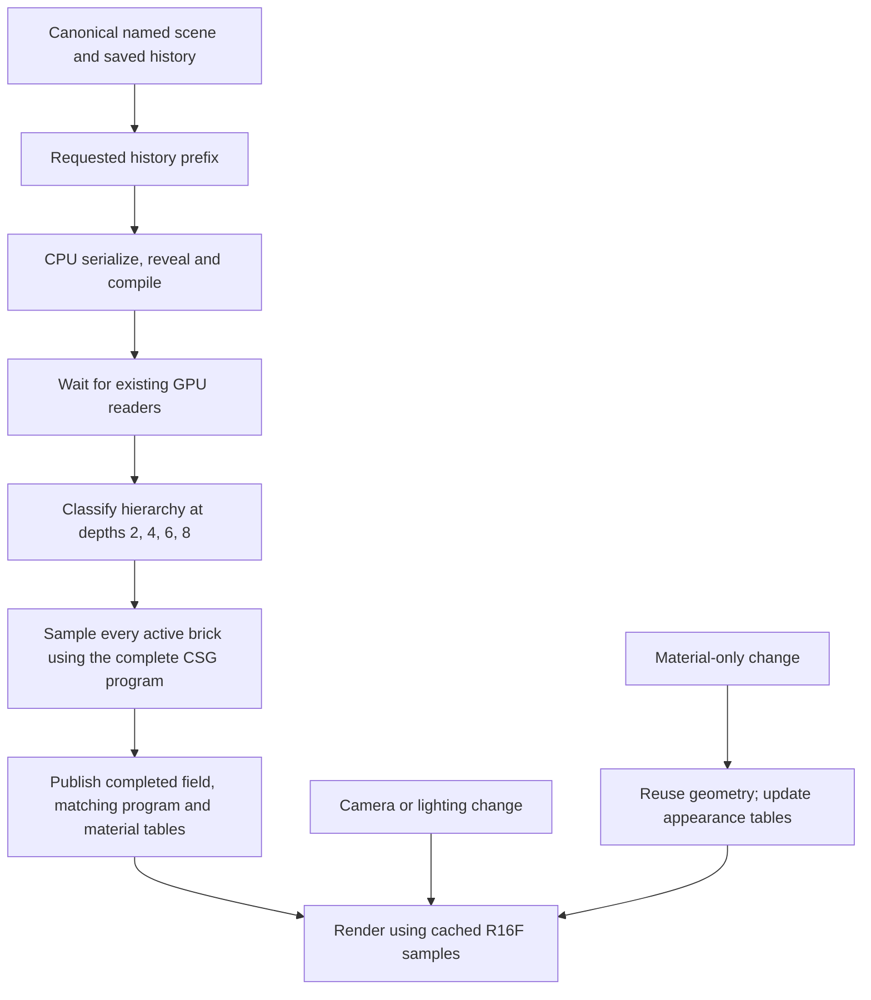

# SDF field-update investigation

Date: 2026-10-26

Status: investigation and proposed next experiment. No accelerated builder,
incremental editing path, renderer change or new authoring interaction is
implemented by this work. Source baseline is
`d0ae6a74b96a4c0e02a1d9dc0600de0b6f7b278a`.

Scope update, later on 2026-10-26: the
[representation, hybrid tracing and history review](sdf-representation-design-review.md)
reopens the design comparison before selecting an implementation. The measured
costs below remain valid. The original pruning-first proposal is provisional;
it does not establish that a sampled final surface or the existing field
representation should be retained.

## Initial finding and proposal

The immediate problem is the cost of evaluating the complete authored CSG
program for every brick sample. Optimize that work before changing field
publication or implementing a persistent dirty-brick allocator.

The proposed first experiment is **exact spatial pruning of the authored CSG
program during full field construction**, using the MIT-licensed
[Lipschitz Pruning reference](https://github.com/wbrbr/LipschitzPruning/tree/b3c5fee4d951ad8942775206d111cd421d2ef31c)
as the implementation reference. Keep the current sampled field, renderer,
canonical scene/history, geometry budgets and completed-field publication.
Qualification of that reference and a bounded comparison come before adoption.

This accelerates rebuilding an edited scene; it does not itself make the
builder incremental. A successful result would establish a faster fallback
for arbitrary changes, undo and cold loads, and supply useful spatial
dependency information for a later incremental-update experiment.

The robot and Guardian already provide different primitive/operator workloads.
Further large authored pieces are not required to investigate this bottleneck.
Small adversarial fixtures are useful now; a new content piece can follow a
functional milestone.

## Investigation scope and evidence

The [evidence package](../evidence/sdf-field-updates-2026-10/README.md)
contains source/artifact identities, commands, all recorded field-build
measurements, the complete forward-history timing series and CPU probe
results. Raw logs, profiling traces, measurement harnesses and inspected donor
sources remain in `outputs/sdf/field-update-investigation-20261026/`.

This pass:

- Rebuilt the Release SDF application and four C++ test targets from unchanged
  source; inspected the field, history, renderer and shader paths.
- Measured four saved scenes in three shuffled fresh-process runs each.
- Recorded one 196-frame headless forward replay, covering the empty state and
  all 65 committed Guardian states without encoding or image readback.
- Timed the existing CPU scene/history functions in a scratch harness linked
  against the unchanged Release objects, with warm filesystem caches.
- Inspected primary research and pinned source, including licenses and
  integration requirements; evaluated three simple locality counterexamples.

The native device is an NVIDIA GeForce RTX 5070 Ti, driver 610.57.04.
Native runs required Vulkan validation. They ran sequentially; no second owned
GPU benchmark ran alongside them. The initial device snapshot reported 0%
utilization. This is a desktop baseline, not a controlled cross-device study.

## Current data flow

The procedural and authored builders have materially different behavior.
See [field construction](../../projects/sdf/sdf_field.cpp),
[authored history](../../projects/sdf/sdf_history.cpp) and
[application publication](../../projects/sdf/sdf_app.cpp).

### Procedural boxes

`Field::build(span<BoxEdit>)` retains completed batches, filters ordered edit
lists through the hierarchy, and copies or updates bricks. A partial tail is
rebuilt from its completed base; an unrelated recipe or backward prefix can
reset that base. It is synchronous, but already avoids repeatedly evaluating
the complete old edit history. Its technique is specific to the ordered
box-edit representation.

### Authored CSG

`Field::build(AuthoredScene)` hashes the geometry and returns immediately for an
unchanged scene. Otherwise it clears the working hierarchy and rebuilds from
the complete postfix program. Both
[classification](../../projects/sdf/shaders/authored_filter.comp) and
[sampling](../../projects/sdf/shaders/authored_bricks.comp) call
[`authoredDistance`](../../projects/sdf/shaders/authored.glsl), which interprets
every instruction. There are no authored per-cell reduced expressions.

The classification kernel supplies one sample per candidate cell; the sampling
kernel supplies 512 invocations per active brick. Four hierarchy stages and the
final sampling dispatch use synchronous submissions and counter readbacks.
The old displayed field remains intact until the replacement completes.

History seeking first serializes current materials into the scene document,
reveals named leaves and recompiles the surviving tree. This can eliminate
groups and renumber instructions. An ordinal program index is consequently
not a stable identity for future edit invalidation. Current history represents
revealed leaves of a saved tree, rather than a general mutation/undo log.

Geometry and appearance identities are separate. Material ownership, material
domains and recipe values must keep their existing geometry-cache behavior.
Distance-only acceleration need not change the full surface/material evaluator.

## Fresh measurements

### Full field construction

Each row is the median of three fresh-process runs, with required validation,
atlas axis 64, depth 8, 8-cubed R16F bricks, supersample 1 and two render-only
frames at 320x180. Render extent does not change field resolution. Each timing
column is summarized independently.

| Scene | Leaves / instructions | Active bricks | Field wall ms | Filter GPU ms | Sampling GPU ms |
| --- | ---: | ---: | ---: | ---: | ---: |
| Robot field-kit | 82 / 163 | 138,444 | 91.20 | 1.12 | 89.12 |
| Earlier Guardian | 106 / 211 | 107,395 | 95.64 | 1.30 | 93.31 |
| Guardian organic form | 197 / 393 | 106,175 | 176.18 | 2.43 | 172.84 |
| Accepted Guardian marble | 1,011 / 2,021 | 107,286 | 918.07 | 12.44 | 904.29 |

Guardian wall times span 915.67–918.10 ms. Sampling accounts for approximately
98.5% of its full build. Removing all other measured build work would still
leave about 904 ms. Counter readbacks and queue synchronization are real
dependencies, but are not the dominant measured cold-build cost.

The three Guardian scenes have nearly constant active-brick counts while
program complexity and sampling time grow together. This is consistent with
the inspected full-program loop. It does not isolate instruction throughput,
memory bandwidth, occupancy or register spilling; those require shader-level
profiling before proposing corresponding micro-optimizations.

The final scene samples 54,930,432 points. At 2,021 instructions per point,
the sampling kernel performs about 111 billion logical interpreter instruction
visits, before classification. This is workload arithmetic, not a hardware
instruction count or a prediction of pruning speedup.

### Updates within one running process

The existing `sdf.prepare_geometry` CPU span surrounds prefix preparation,
queue idle, field construction and renderer publication. Selected committed
states from one forward replay are:

| State | Leaves | Field build ms | Prepare through publication ms |
| --- | ---: | ---: | ---: |
| 1 | 1 | 2.33 | 13.45 |
| 16 | 155 | 137.26 | 149.27 |
| 32 | 389 | 350.65 | 364.59 |
| 48 | 729 | 660.83 | 677.45 |
| 64 | 999 | 912.21 | 932.13 |
| 65 | 1,011 | 923.61 | 924.37 |

Every state from 1 through 65 appears exactly once, plus the initial empty
state. This is a single traversal with varying workloads, not repeated latency
samples of the same edit. It includes no native backward, primitive-move or
primitive-delete benchmark. Unchanged frames retained the existing field.

The unusually small final-state overhead is expected: requesting the full
history returns the complete saved scene directly. A partial prefix takes the
serialization/reveal/recompilation path.

### CPU work

The scratch CPU probe uses seven warmups and 31 measured calls per prefix.
Guardian partial-prefix preparation ranges from 8.40 ms for the empty prefix
to 15.85 ms at state 64; the final-state copy is 0.060 ms. Robot partial
prefixes range from 0.68 to 1.18 ms. Warm-file Guardian loading is 7.78 ms;
its geometry hash is approximately 0.082 ms.

CPU prefix construction is secondary to the current late Guardian rebuild.
It would consume a significant part of a future 16–33 ms interaction budget,
so a fast GPU result must not be described as continuous-editing readiness.

The accepted Guardian also has a specific workload composition: 996 rounded
cones, 965 hard unions, 40 smooth unions and five smooth subtractions. Its
maximum postfix stack occupancy is four. Robot covers the other supported
primitive types, hard cuts and multiple materials. Neither scene alone is a
complete acceleration acceptance suite.

## Memory and publication constraints

The current field allocates 912,997,552 bytes, about 871 MiB:

| Allocation | Approximate MiB |
| --- | ---: |
| Two R16F atlases | 512.00 |
| Two dense node arrays | 146.29 |
| Procedural edit headers | 146.29 |
| Procedural reference storage | 64.00 |
| Frontier pair | 2.00 |
| Small edit/program/counter buffers | 0.13 |

The edit headers/reference storage are allocated even for authored-only use;
they are a possible independent memory reduction of about 210 MiB. Removing
them alone does not eliminate full-program sampling. This is allocation
accounting, not measured per-buffer residency or an implemented saving.

Pruning adds a memory problem of its own. Storing the full 2,021-instruction
program as 64-byte records at every one of 107,286 active bricks would require
about 12.92 GiB. Even one 32-bit index per instruction per brick is about
827 MiB in that worst case. Hierarchical reuse, compact references, bounded
scratch, explicit overflow behavior and fallback are essential. Retain the
existing 2 GiB field-resource limit while evaluating a candidate.

True local brick reuse also needs stable addressing or deliberate remapping:
the current full rebuild assigns compact atlas indices from the new frontier.
Skipping writes while changing those indices would associate cells with the
wrong data. A local edit can change empty/filled/subdivided states and their
ancestors, so updating sample texels alone is insufficient.

In-place mutation would also change failure semantics. Future asynchronous
publication must retain a matching field, scene program and appearance version
until the new version completes; double buffering by itself does not establish
concurrent reader safety or cancellation behavior.

## Why brush bounds are not an invalidation proof

A primitive has bounded solid geometry, but its distance function has global
support. Three independent double-precision sphere probes demonstrate the
distinction; exact inputs and outputs are in the evidence JSON:

1. Adding a sphere centered at x=0.30 with radius 0.05 changes a union's value
   at x=0.20 from 0.10 to 0.05, outside the added sphere's bounds.
2. Subtracting a radius-0.05 sphere from a radius-0.30 sphere changes the value
   at x=0.10 from -0.20 to -0.05, outside the cutter's bounds.
3. Radius-0.10 spheres at x=0 and x=0.21 have a hard-union distance of +0.005
   at x=0.105. A smooth union with radius 0.04 gives -0.005: a bridge appears
   outside both primitive bounds.

This does not rule out local updates. It rules out treating a visible primitive
box as sufficient proof for preserving exact cached values. A narrow-band or
zero-set-only update contract can be viable, but needs its own conservative
distance, hierarchy, interpolation, boundary and traversal qualification.
Smooth influence and transformed ancestors need explicit treatment.

## Primary research and source comparison

The research selection follows the repository's
[reference-first workflow](../architecture/rendering-feature-workflow.md).
References were inspected, not ported or benchmarked locally in this pass.

| Approach / primary reference | What it offers | Cubey fit and cost |
| --- | --- | --- |
| [Lipschitz Pruning paper](https://wbrbr.org/publications/LipschitzPruning/) and [pinned MIT code](https://github.com/wbrbr/LipschitzPruning/tree/b3c5fee4d951ad8942775206d111cd421d2ef31c) | Hierarchical region-specific simplification of hard/smooth CSG. | Strongest first donor: C++/Vulkan/GLSL, flattened primitive transforms and four-way-per-axis refinement match existing concepts. Adapt its algorithm into Cubey's bounded builder rather than importing its host/allocator/renderer. |
| [Massively Parallel Rendering, 2020](https://www.mattkeeter.com/research/mpr/) | GPU interval evaluation and reduced arithmetic expressions; supports a broader class of continuous functions. | Useful algorithmic comparison. Its CUDA/libfive architecture and arithmetic representation make it a larger change than the selected primitive/operator problem. |
| [Fidget pinned source](https://github.com/mkeeter/fidget/tree/17853f767b05a5b70bb835a63238ca3174f1204f), [GPU simplifier](https://github.com/mkeeter/fidget/blob/17853f767b05a5b70bb835a63238ca3174f1204f/fidget-wgpu/src/shaders/tape_simplify.wgsl) | Interval/trace-based arithmetic-tape simplification, including a current WGPU backend. | Active reference for generic implicit evaluation. Rust/WGSL, arithmetic lowering and MPL-2.0 source have a different integration surface. Current source, rather than older CPU-focused descriptions, informed this comparison. |
| [NVIDIA GVDB](https://github.com/NVIDIA/gvdb-voxels/tree/8fa911ffbfd22c088cd5f003742b209bec83fb0c) | Sparse volume allocation, computation and rendering; Apache-2.0 license in the inspected root license file. | Relevant to a later representation/allocator study. Its CUDA-centered volume library is a broad dependency change and does not directly solve authored expression evaluation. |
| [Vulkan indirect dispatch](https://docs.vulkan.org/refpages/latest/refpages/source/vkCmdDispatchIndirect.html) | GPU-provided dispatch dimensions can remove CPU counter round trips. | Later scheduling optimization. The current command recorder supports it, but the graph usage contract must represent indirect reads correctly. Current measurements do not justify prioritizing it. |

### Exact pruning and approximate far-field culling are separate

For 1-Lipschitz child functions in a cell enclosed by radius R, a center-value
separation greater than `2R + k` can certify that one branch dominates throughout
the cell; k is the compact smooth-blend radius. Signed/complemented operands
must be handled correctly for subtraction. This is the relevant
[pruning criterion](https://wbrbr.org/publications/LipschitzPruning/documents/LipschitzPruning_submitted_to_EG25.pdf).

The donor also replaces far-field expressions with conservative constants.
Those preserve a useful distance bound, not the original distance values.
Its paper explicitly leaves partial updates of the pruning structure as future
work. Thus its published renderer speedups neither predict Cubey performance
nor establish a ready-made incremental field updater.

The first proposed comparison should use exact branch pruning only. It must
retain workspace clipping, subtraction signs, original operator order and
floating-point safety margins. Current primitives and smooth operators already
have conservative-gradient coverage, but pruning needs its own numerical
boundary cases. Avoid pruning on an uncertified center winner alone.

The inspected donor uses buffer device addresses, narrow integer storage and
subgroup operations, plus large mutable/scratch arrays. Those are integration
assumptions to review, not features to enable globally by copying the donor
context. Its code is MIT; donor scene assets have separate attribution terms.
Using Cubey's own scenes avoids treating the source license as an asset license.

## Alternatives and proposed order

| Candidate | Assessment for the next experiment |
| --- | --- |
| Exact per-region CSG pruning during full authored rebuild | Investigate first. Targets the measured dominant work and supports arbitrary requested scene states without persistent edit diffs. Pruning construction cost and memory remain unmeasured in Cubey. |
| Persistent dirty-brick updates | Investigate after the evaluation baseline improves. Needs conservative dependency/influence rules, topology updates, stable storage, reclamation and rollback. It may complement pruning. |
| Baking a base field plus a short edit tail | Natural for an explicit append-only brush product. Repeatedly combining sampled fields changes approximation behavior and does not automatically preserve the current nested grouped tree or arbitrary history seeking. Requires a selected authoring contract. |
| Cache complete history fields | Expensive memory tradeoff and replay-specific benefit; does not solve editing an existing scene. CPU prefix caching is smaller, but currently secondary. |
| GPU-driven dispatch / asynchronous building | Addresses waiting or responsiveness while old content remains visible. It does not remove the approximately 904 ms of measured sampling. Versioned publication would need separate design. |
| Lower-resolution preview, altered field representation or analytic renderer | Potential future quality/latency tradeoffs. They change the comparison contract or rendering path and should not be mixed into the first acceleration experiment. |

## Proposed bounded experiment and acceptance

These are proposals for the next implementation discussion, not adopted
runtime requirements or a completed implementation plan.

1. **Qualify the donor core in isolation.** Map its pruning criterion, signed
   operands and compact expression representation to Cubey's seven primitives
   and four binary operators. Run the reference and establish small known-answer
   comparisons before integrating a new builder. Preserve license/provenance.
2. **Compare full rebuilt fields.** Add an explicitly selectable candidate
   builder while retaining the current implementation. Keep resolution,
   hierarchy/tracer, recipes, scene hashes, shaders unrelated to construction
   and accepted appearance fixed. Record pruning, sampling, CPU preparation,
   total publication time, active-node distributions and scratch high-water use.
3. **Use clear viability gates.** A proposed useful first bar is at least a
   fivefold reduction in late Guardian preparation/publication latency, with
   no significant Robot regression and the existing 2 GiB resource limit. Define
   the small-scene regression tolerance before the comparison. This is a target,
   not a promised result; a sub-100-ms edit budget remains a further milestone.
4. **Decide on true incremental updates from that result.** A first implementation
   can still rebuild on every geometry change. If that remains too slow for a
   selected interaction, design local updates around measured workloads and
   explicit invalidation/publication contracts.

Correctness gates should cover:

- Stored distances and hierarchy classifications against the reference at
  identical spatial coordinates. Start with exact R16 sample agreement where
  attainable; establish any numerical tolerance before acceptance and preserve
  the existing ray/part/ambiguity bounds. Pixel similarity alone is insufficient.
- Hard and smooth operations, nested cuts, negative selected operands,
  rotated/scaled groups, workspace clipping, thin features and near-tie margins.
- All saved history states, forward/backward/reset, atomic mirrored actions,
  save/reload, material-only cache reuse and stable cut/material ownership.
- Small fixtures for moving/removing/replacing geometry and changing a smooth
  radius. Saved replay alone is not mutation coverage.
- Bounded reference/scratch/frontier overflow, failed-build recovery and
  retention of the last complete field. Overflow can fall back to the reference
  builder before publication if the reference scene itself fits; do not publish
  a truncated pruned program.
- Native surface/depth/normal/shadow and optical-interface checks on the same
  scenes, followed by visual review. A new distance-only cache must not silently
  prune material identity or blending semantics.

The acceptance report must keep cold construction, warm preparation through
publication, GPU rendering and input-to-visible interaction distinct. The
current replay profile does not measure native event handling, a presented
frame, undo latency or continuous brushing.

## Verification and limits of this pass

- Release build completed; existing shadow/signedness compiler warnings remain.
- Six scoped SDF CPU CTest suites passed.
- Twelve fresh-process native builds and the complete forward replay exited
  successfully with required Vulkan validation.
- The three locality counterexamples matched their analytic expectations.
- Native CPU/GPU field oracles, backward/mutation latency, donor execution and
  accelerated-path visual/performance acceptance were not performed here.

The [Guardian closeout](sdf-guardian-closeout.md), shared material contract and
accepted artistic boundaries remain the starting content checkpoints. This
investigation supplies a measured direction for functional work without
reopening those content decisions.
