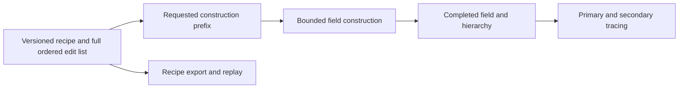

# SDF project implementation plan

Date: 2026-10-21

Status: selected for incremental implementation, with a static stick-ball image
ahead of persistence and playback polish. Implementation evidence belongs in
the SDF project guide as checkpoints land. The [architecture review](projectr-architecture-review.md)
and [development history](projectr-development-history.md) describe projectR;
the [exploration record](sdf-projectr-port-exploration.md) retains broader
rendering, authoring and AI-content experiments.

## First deliverable

Build `projects/sdf` as a native Cubey rendering experiment. The first finished
demonstration is a procedurally constructed ball of sticks above simple ground,
with orbit controls, repeatable construction playback, shared atmosphere
lighting, mapless shadows and optional local ambient occlusion. A diagnostic
view explains the hierarchy and ray traversal using the same scene.

The learning objective is to make the full path from ordered primitive edits
to a cached field and a shaded image understandable. The visual objective is
a deliberate short presentation that works without a hand-sculpted model.
Actual captures determine whether the recipe and presentation succeed.

V1 does not require desktop sculpting, VR, imported assets, learned generation,
GI, a general SDF engine or a second permanent renderer. A terrain-background
audition follows the core demonstration and does not block it.

## Renderer and source selection

| Decision | Proposed choice and reason |
| --- | --- |
| Main donor | projectR `develop` at `6a7c5f9a8a6d58ad5d07850b1b625b399385a2f0`: the later hierarchy, sampled bricks and root-volume tracer form one coherent starting path. |
| Earlier renderer | Keep the January sampled/analytic/hybrid implementation as documented comparison material. Use direct box evaluation for small correctness fixtures; do not initially port the entire old renderer/UI alongside the new one. |
| Geometry semantics | Port boxes with source dimensions/rounding, transforms and ordered fill/remove inside the bounded unit workspace. Additional primitive functions and mirroring wait for a scene or experiment that needs them. |
| Initial construction strategy | Retain the paired committed/working fields as a reference implementation, with explicit completed-batch commits and a bounded allocation profile. Profile its copying cost before selecting a replacement. |
| Intentional changes before acceptance | Preserve the complete recipe, correct unsafe skipping and hit/depth reporting, make limits explicit, define CPU/GLSL storage layout, and rebuild only when geometry changes. |
| Appearance | Establish simple source-derived direct/environment shading first. Add hard shadows, soft shadows, local occlusion and presentation changes through independently selectable modes. |

This follows the [reference-first workflow](../architecture/rendering-feature-workflow.md).
Faithfulness applies to geometry and understandable algorithmic correspondence;
identified batching and traversal defects are not compatibility requirements.
Until an old Unity capture is available, describe results as source-derived
rather than claiming pixel parity with the original.

## Representation and update contract

Separate the canonical sculpture description from derived GPU state:

The CPU recipe retains every box edit in order, including operation, transform
and dimensions. V1 needs no generic primitive registry or shape-selection UI.
A seed and generator parameters are useful metadata, but captures also identify
the explicit generated list.
Use a specified random generator and float mapping; identical Unity/C++ seed
numbers alone do not establish identical scenes. Keep the JSON encoding local
to this project and version it so future recipe changes are distinguishable.

GPU headers, filtered edit lists, bricks and committed prefixes are disposable
caches. Saving does not serialize only the current batch. Reset clears the
whole derived field state; loading or regenerating a recipe rebuilds it.
Backward playback can initially rebuild the requested prefix from the recipe;
instant arbitrary scrubbing and an undo framework are not V1 requirements.

Use bounded batches, initially at most 128 edits, within the source's eight-bit
count limit. Finish building a batch before promoting it to the committed base.
Appending an edit never flips field buffers. If a timeline step crosses a
boundary, process each complete batch in order, then its partial tail.

Batch promotion, field reuse and rendering obey GPU-owner completion and frame
dependencies. Do not overwrite a field still being read by an in-flight frame.
Render the completed requested prefix; a partial or failed build is not a
completed scene. Build only when the recipe or requested prefix changes.
Camera, light, exposure and diagnostic changes reuse the field.

Use a fresh, explicit CPU/GLSL storage contract. The HLSL edit record's 48-byte
size does not imply that a GLSL struct containing `vec3` has identical offsets.
Check size, offsets, quaternion component order and inverse transforms against
small known examples instead of copying host math types directly into buffers.

## Construction and traversal boundaries

Port the four hierarchy stages and leaf sampling with project-local resources.
Permit smaller fixture profiles while retaining depth 8 and 8-cubed bricks for
the detailed stick scene. Preserve the source level offsets and packing only
where their capacities and bounds are checked.

The initial reference builder may read counts between construction stages.
Those waits belong to geometry construction, never to rendering an unchanged
object. Record them separately from GPU filtering, sampling and brick-copy
time. This is an explicit starting tradeoff, not an asynchronous-builder claim.

The tracer must:

- Intersect the actual workspace bounds and advance through empty cells using
  cell bounds, replacing the unsafe enclosing-sphere exit.
- Distinguish a hit, a miss and iteration exhaustion. Reaching a step limit
  must not silently shade a nonconverged sample.
- Handle rays parallel to cell faces, grazing rays and a camera inside the
  workspace. Define and test how rays starting inside a solid find an exit.
- Respect brick intervals and derive tolerances/normal differences from field
  spacing and coordinate scale. Treat the interpolated field as an
  approximation; compare fine-feature hits against analytic fixtures.
- Export depth from the actual world-space surface hit, following Cubey's
  camera/projection convention. Misses leave the background/depth untouched.

Every append/list/brick allocation needs a capacity check before writing.
Packed-pointer width, physical buffer size and atlas capacity are separate
limits. Overflow halts playback/build publication with an explicit diagnostic;
headless captures fail rather than silently accepting missing geometry.
An available committed prefix may remain visible while the failure is shown.
Do not automatically enlarge memory or silently reduce the requested scene.

## Cubey integration

Use `cubey_project_sdf`, output name `sdf`, through the existing
[`cubey_add_app_target` examples](../../projects/fractal_2d/CMakeLists.txt).
Keep the domain code under `projects/sdf`, using these responsibility groups:

| Group | Responsibility |
| --- | --- |
| Config and app | Existing configured-app entry point, schema, filtered input, orbit/zoom and playback controls. |
| Recipe and timeline | Primitive/edit data, deterministic stick generation, full recipe persistence and time-to-prefix mapping. |
| GPU field | Explicit upload layout, bounded hierarchy/filter/sampling resources, batch lifecycle and capacity status. |
| Renderer | Ray generation, traversal, hit depth, shading, diagnostics and final graph composition. |
| Capture and checks | Existing host capture/profiling services, focused CPU/GPU fixtures and reproducible scene presets. |

Reuse [OrbitController](../../include/cubey/input/orbit_controller.h) and the
[configured app](../../include/cubey/host/configured_app.h) contract rather than
inventing a separate control/config system. The current controller supplies
orbit/zoom; any pan offset should be a small project-local addition if needed.

GPU creation, uploads, submissions and retirement follow
[ProjectGpuServices](../../include/cubey/engine/project_gpu_services.h) and the
existing owner contracts. Initial work can use one graphics/compute queue;
asynchronous compute and resource streaming are not prerequisites.

Use an SDF-specific pass on the
[render graph](../../include/cubey/render/render_graph_builder.h), with linear
HDR color and real hit depth. Reuse
[atmosphere environment lighting](../../include/cubey/engine/atmosphere_environment_runtime.h)
and [HDR post-processing](../../include/cubey/render/hdr_post_frame.h). The
sky, object and ground share one lighting/exposure setup, with a single final
display transform. A simple receiver plane can query the SDF for shadows.

Start with the baseline without shadows, matching projectR's saved mode.
Then check the hard-shadow origin/termination before softening it. Local AO
affects environment visibility and remains separately switchable. It does not
stand in for bounced light. Use a plain uniform material initially; procedural
color and alternative material treatments can be compared after geometry is
stable. A background image alone does not count as shared atmosphere lighting.

An optional [TerrainBackdropRuntime](../../include/cubey/engine/terrain_backdrop_runtime.h)
audition follows correct foreground depth. It uses the same world-scale and
camera conventions, with explicit foreground/background composition if their
depth ranges differ. Terrain/SDF mutual shadows, local reflections and GI
require additional geometry queries; sharing depth alone does not provide them.
Keep cloud/volume composition out of the first integration pass.

One bounded foundation gap is already visible: the
[command recorder](../../include/cubey/vulkan/command_recorder.h) supports
indirect dispatch, but the graph's buffer usages do not include indirect-command
reads. If profiling selects GPU-driven construction, add that narrow access
contract and synchronization tests before using it in a graph. Do not label an
indirect-command read as a storage read or start a general scheduling rewrite.

## Checkpoints and deliverables

| Checkpoint | Work and observable exit condition |
| --- | --- |
| M0: recipe and correctness fixtures | Define box/transform conventions, explicit GPU packing and deterministic prefixes. Retain the full CPU edit list immediately; file persistence follows the first image. CPU checks cover ordered box CSG and batch boundaries. Confirm R16 sampled/storage format support and device limits. |
| M1: first native image | Port field construction and primary traversal for an axis-aligned box, rotated box and box subtraction. Capture normals, depth and plain shading; check occlusion against a simple rasterized receiver/occluder. GPU validation is clean, and misses/step exhaustion are distinguishable. |
| M2: static stick-ball demo | Add the procedural recipe, completed-batch promotion and orbit/zoom. Capture the actual stick ball before playback polish. Record allocation, capacity, build/copy cost and steady render cost. |
| M3: lit presentation | Add shared atmosphere lighting, the ground receiver, checked hard shadows and soft shadows. AO remains optional. Deliver native stills and an orbit capture; inspect fine features, lighting and motion. |
| M4: replay and qualification | Add complete recipe export/reload, deterministic construction replay and diagnostics. Run the fixed scene/camera matrix, assess visual defects and measured bottlenecks, and document actual limits. Optimize only what the measurements identify. Publish no performance or visual-acceptance claim based only on builds or PNG existence. |

Each checkpoint should leave a runnable state with a small capture set and
recorded parameters. Early implementation stays isolated from other active
branches/worktrees. Resource/API extraction follows an actual shared need;
the first SDF implementation remains project-local.

The first implementation slice is M0 plus the smallest M1 fixture: one box
through GPU construction and traversal, with a native normal/depth capture.
This exercises the real pipeline before investing in the whole stick scene.

## Presentation and controls

Start with candidate presets of 512 sticks for iteration, 2,048 for the main
visual audition and 6,400 as the source-sized stress case. These are requested
workloads, not qualified capacity/performance or approved appearances. Keep the
source-compatible shell radius and dimension ranges in a named reference preset.

The initial authored clip can be 24 seconds: construction over the first eight
seconds, an orbit/hold over the next twelve, then four seconds of diagnostic
comparison. The same timeline drives windowed playback and headless capture.
Map explicit logical time to an edit prefix; render FPS does not decide how
many edits exist. Capture frames must wait for their requested prefix to be
ready, even if offline capture is slower than realtime.

Expose only the controls useful for the experiment: preset/seed/count,
construction progress and playback, orbit/reset, sun direction, material,
shadow softness, AO strength and the selected view. Keep raw allocation and
profiling details in diagnostics. Fast backward scrubbing can wait; rebuilding
a requested prefix is sufficient initially.

Begin with simple neutral material, readable side lighting, restrained
environment fill and a ground shadow. Compare the same object with lighting
features enabled individually. The educational view should explain the
representation without becoming the default presentation.

## Resource and performance targets

The local planning device reports an RTX 5070 Ti with 16,303 MiB VRAM. This is
hardware inventory, not performance qualification.

For the first default field profile, try 64 bricks per atlas axis, 8-cubed R16
bricks and depth 8. Two such atlases require 512 MiB; retaining all of the
source's dense metadata allocations adds about 1 GiB. Set an initial 2 GiB
budget for SDF field/construction resources, including scratch/staging owned
by that subsystem. Shared environment/frame targets are accounted separately.
Compute and report actual allocation sizes before creating them.

That atlas holds 262,144 bricks. The 6,400-stick stress case may exceed it;
overflow is a result to report, not evidence that the scene rendered correctly.
If the main visual preset cannot fit, choose an explicitly budgeted larger
profile or a measured representation change before declaring it qualified.
Do not conceal the issue by changing its count. An R32 fixture comparison can
help diagnose precision, but it is not an automatic format fallback with
unaccounted memory cost.

Planning targets are 60 FPS at 1080p for the steady primary-render baseline and
30 FPS at 1080p for the chosen lit demonstration on the selected device. These
are targets to test, not predicted results. Record the actual device, extent,
recipe/prefix, camera, quality settings and diagnostics state for every run.

Measure construction separately from drawing: CPU waits, GPU filter stages,
sample/copy work, active/copy/recomputed brick counts and allocated bytes.
For rendering, isolate primary tracing, hard/soft shadows, AO and shared post
cost. Include frame-time distribution rather than relying on a GUI FPS number.
Keep expensive diagnostic instrumentation out of the default timing run.

## Correctness and acceptance matrix

Use meaningful small checks before the large scene:

- Box distances, ordered box subtraction, quaternion transforms,
  workspace clipping and CPU/GPU packing agree at known sample points.
- Recipes survive save/reload with all edit identities and order preserved.
  Prefixes crossing 128/129 and 256/257 edits lose nothing. Different legal
  batch sizes and playback frame rates reach equivalent fields within a
  documented storage/sampling tolerance.
- Empty-cell skips do not miss a neighboring primitive. Axis-aligned,
  near-parallel, grazing and inside-volume rays have explicit expected results.
  Brick-face and thin-feature captures expose seams or disappearing geometry.
- Field samples and hit masks are compared with directly evaluated small
  fixtures. Sampled-field error is measured against voxel spacing/precision;
  do not assert exact analytic surfaces from a finite sampled grid.
- Real hit depth correctly resolves objects on both sides of a rasterized
  occluder. Shadow tests include the first brick and a receiver outside the
  SDF workspace, using one consistent light direction.
- Every capacity can be deliberately exceeded without out-of-bounds writes,
  hangs or a successful headless result. Field reset, regeneration, resize
  and shutdown respect in-flight resources and pass GPU validation.

Use the existing PNG/video capture and profile paths from the
[headless host](../../include/cubey/host/headless_png_host.h). Automated checks
establish geometry, lifecycle and reproducibility. Native image inspection
establishes artifact quality; user visual judgment establishes whether the
demonstration is compelling. Keep those acceptance results distinct.

## Decisions triggered by evidence

| Observation | Bounded next decision |
| --- | --- |
| Counter readbacks dominate construction latency | Evaluate GPU counters and indirect dispatch using the existing command recorder and the narrow graph access addition described above. |
| Copying the previous field dominates construction | Revisit projectR's original alternatives: in-place brick updates or retained local edit lists. Select one from measured costs; do not build both by default. |
| Dense metadata/atlas capacity prevents the intended scene | Compare an explicitly larger bounded profile with compact metadata or brick management. Keep the canonical recipe and reference captures fixed. |
| Sampled edges fail the visual audition | Compare against the January analytic/hybrid reference on the failing small scene before deciding whether refinement or field resolution is the right change. |
| The sticks are technically sound but visually weak | Adjust the procedural recipe, framing, material and light as a presentation experiment, retaining the source preset and matched comparison captures. |

Additional primitives and mirroring wait for a concrete use. AI-generated base
geometry, fitted neural SDFs, specialized training, desktop sculpting, GI and
broader scene integration remain in the exploration record.
They can build on a working renderer later without becoming dependencies of
this first demonstration.
