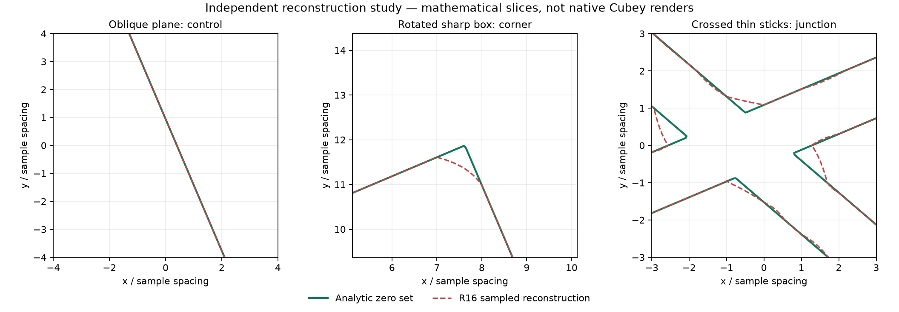
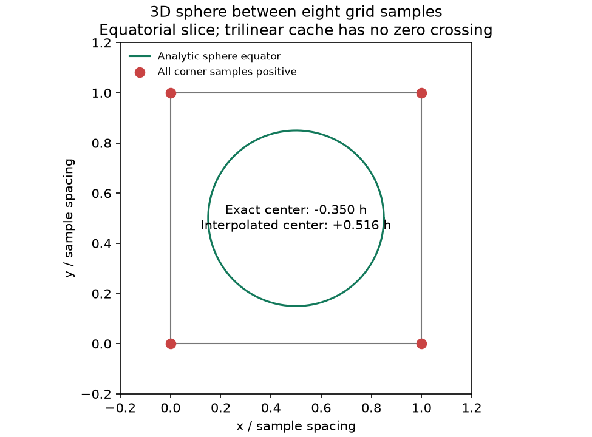

# SDF representation, hybrid tracing and history review

Date: 2026-10-26

Status: research and design evaluation before selecting an implementation.
This broadens the [field-update investigation](sdf-field-update-investigation.md).
Its measured rebuild costs remain valid; its proposed pruning-first sequence
is provisional and is not an adopted architecture or implementation priority.

The later [bounded comparison result](sdf-tracing-comparison-results.md) tests
these hypotheses with opt-in native routes. This record retains the earlier
pre-decision assessment and reference review.

## Assessment

The original projectR design contains ideas worth retaining: keeping authored
operations available, reducing them spatially, and using analytic evaluation
to recover sharp geometric features that sampled reconstruction rounds or
misses. Those ideas are compatible with modern grouped CSG and selected smooth
operators. They do not require returning to a flat, hard-operation-only model.

The unresolved choice is larger than accelerating the existing full rebuild:
what information should remain authoritative, what should be cached, and which
surface should the renderer intersect? Undo is a version/history problem across
all those choices. Current-region pruning alone does not solve it.

The useful next comparison is between the current sampled renderer, a retained
CSG hybrid renderer, and a pruned analytic renderer. A field-oriented alternative
deserves greater weight if relaxing/smoothing existing surfaces or editing
imported fields becomes the selected authoring goal. No winner is established
by the measurements in this review.

## Evidence boundaries

The [review evidence](../evidence/sdf-design-review-2026-10/README.md) retains
source identities, original commit messages, an independent numerical probe,
its figures/results and primary research references. Cubey's runtime source is
unchanged from `d0ae6a74b96a4c0e02a1d9dc0600de0b6f7b278a`.

This pass inspects original projectR history/source, current Cubey source,
primary research and small mathematical counterexamples. It does not launch
Unity, implement a native hybrid tracer, benchmark a candidate GPU pruner,
qualify a smoothing brush, or establish new native visual acceptance.

The user's recollection adds design intent: local CSG retention/compaction was
intended to support both undo and hybrid tracing, and influenced the decision
to avoid smoothing and group/domain modifiers. Source establishes the concrete
behaviors below; it does not independently establish every original motivation.
Both smooth Boolean blends and a surface-relaxation brush are considered here
as distinct meanings of smoothing.

## Reconstructing the original design

| Recollection / question | Evidence | What it establishes |
| --- | --- | --- |
| Sampling hurt rotated hard shapes. | `f2c1887`, 2018-01-20, explicitly investigates jagged rotated-box edges and cleaner directly evaluated edge/intersection lines. | A demonstrated source experiment and contemporaneous quality motivation. Historical FPS reports are not current benchmarks. |
| Hybrid evaluation was a substantial quality feature. | `1ef76e3`, 2018-01-21, adds sampled/analytic/hybrid distance modes, `distance_switch`, separate normal modes and detail-step diagnostics. | The shader really switches to the local edit evaluator near the surface; it is not just a shading effect. |
| Spatial filtering made analytic work tractable. | `673bc16` and `2bfb7c2`, 2018-01-19, add per-brick edit lists and progressive hierarchical filtering. | The renderer could evaluate a region's shortened list instead of the entire scene. |
| Retaining lists was an alternative to copying sampled fields. | `906cb15`, 2018-03-10, proposes retaining previous edit lists; its in-place-field alternative explicitly raises undo/reclamation questions. | The compact-local-program direction was being considered, but the later tip still uses paired sampled fields. |
| Undo worked in projectR. | Earlier chunked generation has job sets, caches and undo/redo, with fixes in `5a56282`. At the later brick tip, undo/redo method bodies are commented out. | Working earlier undo, later scaffolding and intended design must not be conflated. |
| The ball of sticks demonstrated these concerns. | The match-stick test is recorded in the March 10 builder review. The explicit hybrid quality experiment is from January. | The geometry is relevant to thin/sharp-feature stress, but the later ball scene is not itself proof that the January hybrid route remained active. |

The [development-history review](projectr-development-history.md) and
[architecture review](projectr-architecture-review.md) preserve the detailed
history. Cubey initially selected the later sampled renderer. Its procedural
box builder retains spatial filtering and batch reuse; its newer authored
builder evaluates the full grouped CSG program during field construction.
Current primary, shadow and optical-interface traces use sampled geometry.
Authored evaluation after a hit resolves materials/ownership, not an analytic
hit-position correction.

## What hybrid evaluation can and cannot recover

### The sampling problem is more specific than an oblique plane

For a plane, signed distance has the affine form `d(p) = n dot p + c`.
Trilinear interpolation reproduces that function exactly in ideal arithmetic,
irrespective of the plane's orientation. Half-precision storage, hit tolerances,
normal estimation and final pixel sampling introduce separate errors.

A finite box has edges and corners where its distance function changes closest
feature. Hard unions/cuts introduce further changes. Interpolation across those
regions rounds or displaces the zero set. Thin features can disappear between
samples. Thus the original rotated-box observation is well founded, while
"all tilted planar faces are inherently inaccurate" is too broad a diagnosis.

Green is the analytic zero set; red is reconstructed R16 sampled data.
These are independent mathematical slices, not native Cubey images. The
pictured fields are constant in z locally, so their bilinear slices are also
trilinear slices. R16 quantization is performed in Cubey's world-distance units.

At sample spacing h, independent diagnostics find:

| Fixture | Observation |
| --- | --- |
| Oblique plane | Float64 reconstruction error below `8e-15 h` over the diagnostic domain; the ideal reconstruction is exact. |
| Rotated box | Maximum tested radial zero-crossing displacement about `0.461 h`; error concentrates near the corner. |
| Crossed thin sticks | Maximum tested radial displacement about `1.422 h`; grazing directions amplify distance-value errors. |
| Radius `0.35 h` sphere centered between eight samples | Every corner value is `+0.516 h`; trilinear reconstruction has no zero within the cell, although the true center is `-0.35 h`. |

The radial diagnostic uses 4,096 directions, first sign-change brackets sampled
at `h/64`, then bisection. It is neither a 3D Hausdorff metric nor a proof against
narrower sign excursions. Values are specific to these fixtures and grid phase;
they are not measured errors in the accepted Guardian or a native renderer.

### Retaining the source changes the role of the cache

With retained CSG, a sampled cache can guide traversal while the original
expression defines the final intersection and geometric normal. The cache
could potentially be coarser or contain conservative bounds rather than a
high-resolution approximation used as the final surface. This changes both
the quality target and the cache-building workload.

It is therefore premature to require every future design to reproduce the old
R16 values. That was a useful gate for an isolated builder optimization, not a
general product requirement. A hybrid/analytic candidate should agree with the
authored surface, while the sampled renderer remains a measured baseline.

Retained source is not sufficient by itself. A safe hybrid implementation must:

- Keep candidate regions that might contain sub-grid geometry; a final
  refinement cannot recover a region already skipped by incorrect culling.
- Derive the analytic-switch region from a conservative reconstruction error
  or distance bound. A sampled distance alone is not a certified safe step.
- Keep a reduced expression within its valid spatial region; stop or look up
  another region when crossing its boundary.
- Ensure the expression remains valid over normal-estimation stencils, or use
  the appropriate source for each stencil query.
- Treat grazing, inside-solid, thin-feature and near-tie rays explicitly.
  Small fixed minimum steps and a close-looking image are not correctness proofs.
- Define consistent primary, shadow and optical-interface behavior. Sharper
  visible geometry with coarser shadows or thickness can expose inconsistencies.

For a 1-Lipschitz field sampled at spacing h, the ideal trilinear value error
has a bound of `sqrt(3)/2 * h`, plus storage/numerical error. Cubey already uses
a related sampling margin in its tracer and oracle. A hybrid design must use
such bounds to decide where analytic work is necessary, rather than copying an
old `distance_switch` tuning value without checking its assumptions.

Analytic evaluation means evaluating the source function instead of its sampled
interpolant. It does not imply exact Euclidean distance after every Boolean,
infinite numerical precision, automatic pixel antialiasing or zero rendering
cost. Safe distance bounds remain fundamental; see
[Hart's sphere-tracing work](https://experts.illinois.edu/en/publications/sphere-tracing-a-geometric-method-for-the-antialiased-ray-tracing/).

## Undo and the meanings of compaction

Four different operations were getting grouped together:

| Operation | Information retained | Consequence |
| --- | --- | --- |
| Spatially prune a derived program for a cell and scene version | Canonical scene/history still exists elsewhere. | Safe to discard and regenerate the cache; undo can reveal previously pruned branches. |
| Compact GPU storage or remap indices | All semantic records and references are preserved. | Primarily an address/capacity problem; not a change to history. |
| Permanently delete currently hidden operations from the only model | Earlier source states may be lost. | Current appearance does not establish that undo remains possible. |
| Bake operations into sampled values | Their current effect survives approximately; analytic operations may not. | Source editing and analytic refinement need retained source or explicitly historical data. |

An independent information-loss example makes the undo issue concrete. One
history adds a radius-0.1 sphere, then a concentric radius-0.3 sphere. Another
adds a radius-0.2 sphere, then the same radius-0.3 sphere. Both current unions
reduce to the large sphere. Undoing that sphere must reveal different objects.
The identical current pruned result cannot identify which old state to restore.

This does not make pruning incompatible with undo. It makes **current-state
pruning a cache, not the sole history record**. Candidate history strategies
include immutable/versioned source trees, a complete action log with replay,
and checkpoints/deltas for sampled data. These are alternatives to evaluate,
not a requirement to implement all three.

Atomic user actions also need their own semantics. Guardian has 65 grouped
history operations and 1,011 leaves; sampled stroke segments and a mirrored
pair should not automatically become independent undo steps. Moving an earlier
part, changing a smooth radius, undoing material changes and forking after undo
are different contracts from seeking a saved reveal prefix.

### Storage costs should be compared fairly

The current 871 MiB field-resource total includes two atlases, working state
and scratch. It is not the necessary cost of each undo snapshot. One full
published atlas plus one dense node array is approximately 329 MiB at current
capacity; 66 unshared copies would still require about 21.2 GiB. Compression,
sparse deltas and structural sharing could reduce that substantially.

For scale, the current Guardian JSON is 846,117 bytes and its 2,021 compiled
64-byte instructions occupy about 126 KiB, excluding other CPU metadata and
spatial acceleration. Retaining source history is much smaller than naively
retaining full GPU fields, but the latency of rebuilding its derived caches
still matters. No history-memory strategy is benchmarked here.

## Do smoothing and groups still need to be excluded?

### Smooth Boolean blends

Compact polynomial smooth unions/subtractions can retain conservative gradient
bounds. Spatial pruning is possible when its criterion includes the blend
radius. The current
[Lipschitz Pruning reference](https://wbrbr.org/publications/LipschitzPruning/)
explicitly supports hard and smooth CSG; its paper also notes that larger blend
radii reduce pruning efficiency. Its partial-update structure remains future
work, so it does not solve undo or editing by itself.

There is a genuine semantic cost: smooth operations cannot generally be
reordered or flattened like a hard union. A probe using the current polynomial
smooth minimum, `a=0`, `b=0`, `c=.05`, `k=.1`, obtains `-.0265625` for left
grouping and `-.02822265625` for right grouping. A compactor must preserve the
expression's operator structure and radii. Rejecting all smooth operations is
not required; treating them as an unordered local list would be wrong.

### Group transforms

An organizational group or rigid/uniformly scaled group does not impose the
same difficulty as a nonlinear domain warp. Cubey already composes these
transforms down to leaves and scales blend radii, while retaining the named
source tree. The pruning reference likewise preprocesses group transforms.
Keeping those groups is compatible with region-specific distance evaluation.

Nonuniform scaling and shear need appropriate distance/variation bounds and
normal transformations. Nonlinear twist, bend, repetition and displacement
need bounds for their coordinate mapping over the actual query region. A
composition's derivative bound depends on both the field and the mapping's
Jacobian; assuming the original unit bound after a warp can skip geometry.

[MPR's interval/tape approach](https://www.mattkeeter.com/research/mpr/)
is a useful broader reference for continuous expressions, including some
warps that break the unit-Lipschitz restriction. That flexibility has a larger
representation/interpreter cost than using the known primitive/operator set.
General domain modifiers remain a deliberate capability choice, rather than
evidence that ordinary grouping must be excluded.

### A smoothing brush is a different operation

A smooth Boolean blends two source shapes. A relaxation/smoothing brush
changes the existing surface using its neighborhood; it is not automatically
another primitive or a polynomial join. Field-oriented filters naturally
express that work, with stencil support, tracking/reinitialization and history
costs. [OpenVDB's level-set filters](https://www.openvdb.org/documentation/doxygen/LevelSetFilter_8h.html)
provide a concrete reference for this distinction.

A source graph can include an immutable sampled-field leaf plus later analytic
edits, but its original baked content then remains resolution-dependent.
Combining representations is possible; building a universal hybrid authoring
system before choosing an interaction would add substantial scope.

## Alternatives that remain open

Model representation, cache representation, rendering and history are
independent axes. The following are useful combinations, not an exhaustive
list or a forced migration sequence.

| Direction | Main benefit | Main tradeoff / evidence gap |
| --- | --- | --- |
| Retained CSG, sampled final surface, faster builder | Preserves current rendering cost and isolates the measured rebuild hotspot. | Retains sampled sharp/thin-feature limits. A speedup alone does not address the original hybrid quality goal. |
| Retained CSG, local programs, sampled/bounded traversal plus analytic refinement | Closest to the useful original hybrid idea; source defines final geometry and remains available for undo. | Must measure query counts, local-program memory, conservative switching and all ray types. A coarser cache is a hypothesis to test. |
| Retained CSG, spatially pruned analytic rendering | Removes the need to build a dense distance atlas as the final surface representation. | Still needs pruning/acceleration storage and pays source evaluation per ray step. Drawing may cost more than the current static cache. |
| Sparse field as authoritative sculpting data | Natural for neighborhood smoothing, imported fields and freely evolving geometry. | Detail is tied to stored information/reconstruction; history needs field deltas/checkpoints or replayable operations. Primitive-level editing is a different contract. |
| Field or source model with extracted feature-preserving meshes | Allows ordinary rasterized rendering and mesh export; provides a reconstruction alternative to trilinear surfaces. | Extraction/update latency, topology, material ownership and feature recovery must be assessed. It is an additional geometry pipeline. |

There are concrete modern alternatives beyond restoring the old tracer:

- **Lipschitz-pruned analytic CSG** can serve both rendering and discretization.
  Its approximate far-field constants are distinct from exact branch pruning.
- **Interval/tape reduction**, including current Fidget/WGPU source, covers a
  broader expression class. It is not a drop-in replacement for the existing
  primitive program.
- **Derivative-bound caches** are another way to accelerate queries of original
  geometry. [Generalized Lipschitz Tracing](https://onlinelibrary.wiley.com/doi/10.1111/cgf.15202)
  explores this; its fast GPU fitting can underestimate bounds and lacks
  automatic approximation-failure correction. That prevents assuming its
  fastest route is a correctness-ready replacement.
- **Reconstruction from sampled data** can preserve corners better than ordinary
  trilinear zero sets. [Dual Contouring of Signed Distance Data](https://gatc.cs.columbia.edu/projects/dual-contouring-of-signed-distance-data.html)
  provides a current paper and implementation route without requiring an
  analytic source function. It does not establish exact recovery of arbitrary
  missing detail or real-time editing in Cubey.
- **Sparse volume libraries** illustrate storage choices. NanoVDB's documented
  [static tree topology](https://www.openvdb.org/documentation/doxygen/NanoVDB_FAQ.html)
  means GPU-friendly queries alone do not supply dynamic sculpting/undo.

These references were assessed from primary publications and source. None was
ported or benchmarked against Cubey in this pass, and their published speedups
are not used as predictions for this workload.

## What the existing measurements decide, and what they do not

The previous baseline establishes that full authored field construction is
dominated by repeated expression evaluation: approximately 904 ms sampling in
a 918 ms final Guardian build. It also establishes approximately 8–16 ms of
partial-prefix CPU preparation and cheap reuse of unchanged fields.

It does not establish whether sampled construction, hybrid refinement or
pruned analytic rendering gives the best combined quality/editing/rendering
tradeoff. In particular, a direction that avoids the full sampling pass should
not be excluded merely because it changes the sampled renderer. Conversely,
improving sharp edges does not establish acceptable steady-frame or edit cost.

Distance-only pruning must also remain distinct from material pruning. A cut
can take its distance from the cutter while inheriting material from its body.
Removing a distance branch does not automatically remove its relevance to
material ownership. Preserve the existing full material evaluator or supply
an independently qualified provenance scheme; the single-material Guardian
alone will not expose that issue.

## Proposed evaluation before an implementation decision

The next evidence should compare architecture choices, rather than begin a
full feature implementation around the earlier pruning-first suggestion.

1. **A small native surface-quality comparison.** Use the existing sampled
   tracer, a straightforward analytic reference for small source scenes, and
   one hybrid/pruned candidate in isolation. Compare the same source geometry,
   camera, pixel sampling and material. A reference can be slow; it must be
   trustworthy. No editor, arbitrary warp framework or new sculpture is needed.
2. **Fixtures targeted at the original design.** Include isolated tilted planes,
   rotated box corners, hard intersections, stick widths/grid phases, tiny
   cavities, smooth joins at increasing radii, rigid/scaled groups, grazing
   rays and inside-solid exits. Separate hit/depth error, normals, shadows,
   pixel aliasing and field reconstruction error.
3. **A history contract comparison.** Include appending a stroke, undoing a
   covering operation that hid prior geometry, redo, a new edit after undo,
   moving an earlier grouped part and changing a smooth radius. State whether
   history is sequential stroke undo, source-parameter editing or both. Retain
   atomic mirror/stroke semantics and the original source in every candidate.
4. **Matched performance and memory measurements.** Record cold setup, warm
   edit preparation, cache update, publication/first-visible response and steady
   primary/secondary-ray cost separately. Count source evaluations and local
   program sizes. Account for source history, sampled caches, pruning scratch,
   published states and retirement together; do not charge all working scratch
   to each undo state or ignore it in an analytic candidate.
5. **Then choose the capability boundary.** If hybrid quality is valuable and
   its total cost is acceptable, choose its cache/pruning layout from measured
   needs. If analytic rendering wins, avoid retaining a costly atlas solely
   for continuity with the old design. If field smoothing/imported data drives
   authoring, evaluate that representation explicitly rather than disguising
   it as a minor extension to primitive CSG.

For the current limited primitive/operator set, retained CSG remains a strong
candidate because it preserves exact source intent and compact logical history.
Hybrid rendering merits a fair comparison. Smooth Boolean blends and ordinary
group transforms need not be removed in advance. These are assessment results,
not adoption of a cache layout, a particular paper, a new renderer or an editor.

## Validation in this review

The pinned numerical probe checks affine reconstruction, sphere sign loss,
smooth-operation non-associativity and the undo information-loss example.
Its figures were visually inspected. Source and artifact hashes are recorded.
The previous native baseline remains source-matched; no native performance
matrix was repeated for documentation or these independent numerical examples.
No production runtime or shader source is changed.

## Comparison planning

The [tracing/cache comparison plan](sdf-tracing-comparison-plan.md) turns this
review into a bounded proposed native study, with independent references,
scripted action/undo cases, route/resource contracts and checkpoints before an
architecture decision. The plan does not implement or select a candidate.
