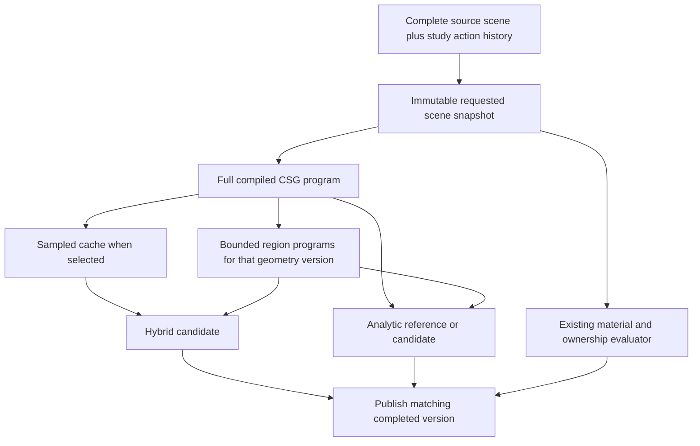

# SDF tracing, cache and edit-history comparison plan

Date: 2026-10-26

Status: retained planning contract for the completed bounded comparison.
The [result](sdf-tracing-comparison-results.md) and
[execution receipt](sdf-tracing-comparison-progress.md) distinguish implemented
controls, qualified scopes and failed practicality gates. No new default is
selected; the proposed targets below are retained for comparison with results.

Inputs: the [representation review](sdf-representation-design-review.md),
[measured build/update baseline](sdf-field-update-investigation.md), original
projectR source/history and Cubey runtime source
`d0ae6a74b96a4c0e02a1d9dc0600de0b6f7b278a`.

## Objective and deliverable

Determine which combination of retained CSG, spatial acceleration and surface
tracing best supports sharp geometry and discrete editable history at acceptable
rendering, update and memory cost.

The deliverable is a runnable, explicitly selected native comparison and a
source-pinned decision report. It must explain which candidates satisfy the
quality/history contracts, their costs and the remaining tradeoffs. Completing
the comparison does not require selecting a winner, replacing the default
renderer, building a sculpting editor or publishing another showcase.

The working first-milestone scope uses scripted edits and undo/redo, with a
bounded windowed inspection. A live editing interaction is a separately
selectable addition; it is not needed to measure or decide this comparison.

## Fixed contracts and deliberately open choices

| Fixed for the comparison | Still open until evidence is available |
| --- | --- |
| The complete named CSG scene and logical actions remain authoritative for the current authored-content workload. | The long-term authoring representation if neighborhood smoothing/imported fields becomes a selected product. |
| Pruned programs, sampled fields and spatial indexes are disposable derived data. Undo must recover hidden source geometry. | Persistent trees, action replay, checkpoints or sparse deltas as the eventual history/cache implementation. |
| Current seven primitives, four hard/smooth operators, rigid transforms and uniform group scale retain their meaning. | General coordinate warps, nonuniform scale/shear, relaxation brushes and larger source budgets. |
| Material ownership, inherited/overridden cut material, domains and smooth blending retain their existing semantics. | Whether material/provenance evaluation later receives its own acceleration. |
| Existing presets use the existing sampled route by default; absent study selection creates no candidate cache or job. | Which candidate, if any, becomes a future default. |
| Geometry, source hashes and authored history formats remain stable across renderer selection. | Final spatial cache layout, hierarchy depth and whether a distance atlas is necessary. |
| Failed or partial construction never replaces the last complete compatible scene/cache/material snapshot. | Asynchronous building, cancellation and edit coalescing, which are outside this milestone. |

These fixed contracts are study requirements, not a commitment that every future
modeling operation must be representable by primitive-only CSG.

## Candidate and control matrix

Separate the surface-tracing choice from the evaluator used by direct CSG
queries. This avoids attributing a quality improvement to pruning or a speedup
to silently changing the surface.

| ID | Surface route | CSG evaluator | Purpose |
| --- | --- | --- | --- |
| S0 | Current sampled tracer | Current complete-program field builder | Preservation/performance baseline, including its documented sampling limits. |
| A0 | Analytic tracer | Full program | Small-scene GPU reference and debugging control; not a practical large-scene candidate. |
| H0 | Sampled/bounded traversal with analytic refinement | Full program | Isolate hybrid correctness and quality before pruning. |
| H1 | Hybrid | Region-pruned program | Candidate combining cache-guided traversal and source-defined surface detail. |
| A1 | Analytic | Region-pruned program | Candidate that avoids building/allocating a high-resolution sampled distance atlas. |
| S1 | Sampled final surface | Region-pruned field construction | Optional builder-only ablation after the same pruner is qualified; not required if it adds unrelated plumbing. |

All production candidates use the existing full material evaluator initially.
A cutter can determine distance while the body determines appearance; distance
pruning is not permission to discard material provenance.

Suggested selector shape, to finalize during the first implementation checkpoint:
an authored-only `surface-trace` enum for sampled/hybrid/analytic and a separate
`csg-evaluation` enum for full/pruned. Existing defaults stay sampled/full.
These are proposed options, not current CLI recipes. Invalid combinations,
including field-only diagnostics on an atlas-free route, fail before allocation.
Configuration/persistence checks must prove an unselected route remains inert.

The first comparison targets authored scenes. The larger legacy procedural
stick/carving recipes remain preservation tests on their current route; do not
raise the 1,024-leaf/2,048-instruction authored limits merely to translate them.
A bounded authored stick fixture exercises the same thin/intersection problem
without claiming parity with the entire historical ball-of-sticks scene.

## Study architecture and ownership

Keep the work project-local under `projects/sdf`. Use the existing executable,
GPU owner services, host, capture, environment and post paths. No generic engine
tracer interface, new application/preset dimension or third renderer project is
needed for this comparison.

Planned responsibilities and code touchpoints:

| Responsibility | Existing code / proposed local addition |
| --- | --- |
| Selection and resource construction | `sdf_config.h`, `sdf_app.cpp`, `sdf_renderer.h/.cpp`; separate selected trace resources from the mandatory `Field` reference. |
| Canonical scene/history preservation | Existing `sdf_authored.*`, `sdf_history.*`; add a small study action driver instead of redefining saved reveal history as arbitrary undo. |
| Reference/equivalence checks | `sdf_validation.*`, existing validation shaders and independent CPU fixture oracles; proposed tracing-comparison tests. |
| Trace kernels | Preserve `shaders/trace.glsl` as S0; add project-local analytic/hybrid includes and selected shader variants using the same query contract. |
| Region pruning | A small local region-program builder and GLSL evaluator, with explicit bounded storage, source references, signs and fallback flags. |
| Fixtures and runner | Project-local comparison scene/ray/action manifests and a tools runner that records versions, results and artifacts. |
| Build/policy coverage | `projects/sdf/CMakeLists.txt`; shader dependencies, selected-route schema and meaningful geometric/lifecycle tests. |

Do not keep a dummy full `Field` allocation solely to satisfy the current
`Renderer::create(..., const Field&, ...)` signature. A1 must operate without
the distance atlases and field-construction buffers; prove that through owned
allocation counters. Tiny, explicitly accounted descriptor placeholders are
acceptable only where an existing shared binding requires them.

The GPU query harness and native rendering must call the same selected trace
implementation. Expected answers must come from independent CPU geometry,
not another copy of the GPU tracer.

## Geometry, numerical and publication contracts

### Source and queries

- Retain the unit workspace and current clipping at half extent 0.499, inverse
  transforms, uniform scale, operator order, blend radii and stable material ties.
- A region program is valid for a specific geometry version and spatial domain.
  Compiled ordinals may change after source recompilation; they are not durable
  edit identities. Keep source names and map derived references per version.
- Return explicit hit, miss, exhaustion and invalid-query states. Budget
  exhaustion is never a miss or a successful surface convergence.
- Report source evaluation counts and pruning fallback use. Use diagnostic
  counters in separate runs from uninstrumented performance measurements.

### Reference accuracy

The existing `validate_field` brackets a sampled surface with a finite-grid
error allowance. Keep that validator for S0/S1; it is too permissive to establish
analytic/hybrid accuracy and must not become their only oracle.

Use independent closed-form ray intervals for spheres/boxes and interval
composition for small hard-CSG fixtures. Smooth fixtures need double-precision
source evaluation with bounded root isolation/bracketing. A dense sign scan
alone is not a proof that thin or tangent intersections were found.

Proposed initial numerical scale, to settle in M0 before candidate tuning:

- Let `h0 = 1/(256*7)` be the current reference sample spacing, even for a later
  coarser hybrid cache. Candidate accuracy must not loosen with cache spacing.
- Start analytic hit residual at `epsilon = h0/32`, approximately `1.74e-5`
  workspace units. For independent regular fixtures with incidence at least
  0.25, start ray-depth agreement at `4*epsilon`.
- Compare geometric normals within one degree on regular patches away from
  creases, using the same analytic finite-difference stencil for full/pruned
  controls. Start stencil spacing at `h0/16`; record it with every result.
- Creases have non-unique normals. Exclude only the predeclared crease stencil
  from angular scoring; keep its hit/depth/material checks and images.
- Give tangencies and grazing rays their own fixture-specific tight brackets
  and expected classifications. Freeze any ambiguity roster before candidate
  output is evaluated. Require zero ambiguity in regular known-answer rays.

These are proposed study tolerances, not existing product guarantees. M0 must
justify them against float32 arithmetic and the source functions before using
them as pass/fail gates. A reference that cannot resolve a case reports it as
unresolved; it does not authorize silently widening tolerances afterward.

### Hybrid safety

Derive the switch from an interpolation/storage/evaluation bound. For current
1-Lipschitz source and ideal trilinear interpolation, start with
`E = sqrt(3)/2 * h_cache`, then account conservatively for R16 and evaluation
error. Document the bound and admissible source operations in M1.

Outside the solid, `g(p)-E` can bound a safe sampled step when positive. When
the sign/step is uncertain, evaluate the source before advancing; do not force
a minimum sampled step through the uncertainty region. Inside-solid queries
need the corresponding sign-aware handling. Cell exits, workspace exits and
normal stencils must remain within the relevant query/pruning domain.

Do not copy projectR's empirical `distance_switch` as a correctness guarantee.
Do not use approximate far-field constants as ordinary exact distance samples.
Coarser-cache experiments follow correct H0/H1 results; they use the same
source-accuracy contract and need their own certified stepping bound.
Keep experimental cache profiles separate from the frozen S0 depth/resolution.
The region-program grid and the sampled-cache spacing are different quantities
and must both be named in the receipt.

### Pruning and bounded storage

Use the inspected MIT-licensed
[Lipschitz Pruning source](https://github.com/wbrbr/LipschitzPruning/tree/b3c5fee4d951ad8942775206d111cd421d2ef31c)
as the first donor candidate. Qualify its core before integrating it. Preserve
license/attribution and pin the copied source; import no donor scene assets.

Preflight the donor's dependency/features and allocation requirements on a small
scene. Run its original compute core in an isolated harness; use its headless
application only if its requirements fit the study. Record any host, packing
or capacity adaptation explicitly. Failure to run the donor is a reported
qualification gap, not evidence that a fresh reimplementation is equivalent.

Start with exact branch pruning, including subtraction complements and compact
smooth radii. Use the strict dominance margin over the whole region, including
evaluation uncertainty. Preserve parent/operator structure and root clipping.
Current groups are flattened rigid/uniform transforms, not general warps.

The first region-query experiment uses bounded hierarchical regions, beginning
with the donor's four-way-per-axis refinement through resolutions 4/16/64.
Depth 8/256 is a measured follow-up only if the earlier level's memory/query
counts justify it. Record near-surface and all-region statistics separately.
Do not allocate the worst-case full program per leaf.

Prefer ordinary 32-bit derived references for the first comparison. Narrow
packing, buffer device addresses and subgroup-specific optimizations are not
reasons to expand global device requirements. Track every reference/scratch
capacity and test exhaustion before publication. If a cell uses the full source
as a correctness fallback, mark and count that fact in the result.

### Completed-version publication

Treat source, selected trace caches, full material program and appearance tables
as one published snapshot. Geometry/appearance content hashes keep their
existing meaning; request/version labels are additional study provenance.
Publish only when construction and validation of that requested version succeed.
Failure retains the previous compatible snapshot and reports the failed request.

Material-only edits reuse geometry caches. New snapshots must not overwrite
buffers still read by an in-flight frame. Begin with synchronous owner-ordered
publication, keeping at most the required working/completed caches. Background
builds, queue splitting and cancellation are not part of this milestone.

## Bounded fixture and action matrix

M0 freezes an initial roster of at most 32 small scene variants. Changes to that
roster get a new manifest revision; do not silently expand the first pass into
hundreds of captures. The families below can share source scenes and targeted
ray sets instead of multiplying every parameter combination.

| Family | Required cases and question |
| --- | --- |
| Planar control | Central face of a large tilted slab/box, with edge regions masked; separate orientation from corner/interpolation error without adding a plane primitive. |
| Sharp boxes | Axis-aligned, 23-degree and 45-degree boxes; selected integer/half-sample translations; corners and hard intersections. |
| Thin construction | Bounded crossed sticks and small bores at selected widths `0.5 h0`, `1.5 h0`, `4 h0`; preserve world scale rather than enlarging the geometry for a screenshot. |
| Missing sampled features | Sphere and cavity between sample vertices, with an aligned control; analytic source has geometry even where the sampled zero set disappears. |
| Material-sensitive cuts | Inherited body material and explicit cutter override, plus smooth material blending; geometry-only pruning must not change ownership. |
| Smooth CSG | Union/subtraction with selected small/medium/large radii and nested grouping; no reassociation of smooth operators. |
| Transforms and boundaries | Named group versus independently flattened equivalent; rigid/uniform scale, workspace clipping, cell seams, inside and near-parallel rays. |
| Optical compatibility | One small existing bounded glass case, with primary and secondary interface queries; no new transport model. |

Use exact primitive fixtures to cover all seven primitive types, and the
existing Robot for mixed-material/content coverage. Quality captures use
fixture-defined region-of-interest ray cameras in the diagnostic harness;
the app's current orbit-distance clamp must not force undersized fixtures to
be scaled up and hide the sampling problem. Native PBR/environment inspection
comes after geometry diagnostics agree.

Study actions form a small separate replay format that emits valid scene
snapshots. Preserve existing saved construction/reveal histories and V2/V3
scene serialization; do not turn them into an incompatible general editor log.

| Action sequence | Required result |
| --- | --- |
| Add small object; cover it with another; undo; redo | Undo restores the hidden source, even if absent from the current pruned cache. |
| Undo; add a different action; attempt redo | The abandoned redo branch is unavailable; the new history and displayed version agree. |
| Add/undo a mirrored stroke | Both sides change atomically as one action. |
| Move/rotate/uniformly scale an earlier named group | Dependent geometry, spatial caches and depth are regenerated for the requested version. |
| Change a smooth radius; undo it | Original grouping/radius and surface are restored. |
| Change a material/domain/cut owner | Geometry cache build count stays unchanged; appearance and persisted values update correctly. |
| Inject a reference/scratch/frontier failure | Previous complete source/cache/material snapshot remains queryable and visible; retry is explicit and deterministic. |

A CPU action log plus valid source snapshots is sufficient for this experiment.
It proves semantics and exposes update costs; it is not a final persistent-tree
implementation or a claim of responsive continuous sculpting.

## Implementation checkpoints

| Checkpoint | Bounded work | Exit evidence / reason to stop |
| --- | --- | --- |
| M0: freeze contracts and controls | Finalize fixture/action manifest, CPU known-answer oracles, numerical tolerances, route/resource accounting and benchmark schema. Preserve source hashes and current sampled results. | Independently reproducible expected rays/versions and explicit unresolved cases. No candidate implementation if the reference contract is unclear. |
| M1: full analytic and hybrid controls | Add A0/H0 for small scenes; selected route resources, shared GPU query harness, safe hybrid stepping, analytic normals and depth. No pruning yet. | Quality/coverage agrees with independent source references; hidden-feature and seam cases pass. Capture the benefit and full-query cost. If the expected quality benefit is absent, investigate before adding a pruner. |
| M2: qualify region pruning | Run the original donor core in isolation where practical; compare a bounded local adaptation with the full source at identical points. Measure exact-program sizes and storage. | Signed/rotated/smooth/nested examples pass; capacity/fallback behavior is correct; equivalence holds at boundaries and normal stencils. Stop for unsuitable memory/complexity rather than replacing the entire expression system. |
| M3: compare H1 and A1 | Use the same qualified pruner in both candidates. A1 allocates no full brick field. Add history-action scripts and a second, explicitly coarser hybrid cache only after the initial profile passes. | Matched quality, action/publication, memory and GPU results; no hidden fallback or cache work attributed to the wrong mode. S1 is optional evidence if cheap to obtain with this pruner. |
| M4: content and decision review | Run bounded Robot/Guardian qualification, selected construction states, final material/optical checks and one native windowed inspection. Produce the comparison report. | A traceable Pareto comparison with limitations, target misses and explicit next decision. No automatic default switch, editor build or public media refresh. |

M0/M1 should remain small enough to review before M2/M3. Each checkpoint has a
source/artifact receipt. A checkpoint failure produces a concrete investigation
or a stop decision, not an automatic expansion into a new renderer framework.

## Measurement protocol and proposed targets

Use the local RTX 5070 Ti baseline as the first comparison device, recording
current driver, source, binary/shader hashes, input hashes and environment.
Refresh the source-pinned baseline if runtime hashes change. Run one owned GPU
measurement process at a time; retain warmup and run-order information.

For correctness, use bounded ray/query sets before high-resolution drawing.
For practical candidates, step through 320x180, 960x540 and then 1920x1080 only
when work counts and lower-resolution timing justify it. Do not run the
unpruned thousand-leaf reference at full HD just to fill a table. A0 remains a
small-scene oracle; an unsupported/too-slow measurement is reported explicitly.

Use at least three interleaved repetitions for the final practical-candidate
matrix. Match camera, source, lighting, quality and state. At full HD begin with
180 frames / 30 warmup, report complete GPU samples and median/p95, and keep
instrumented query-count runs separate. Plain opaque diagnostic scenes precede
hard-shadow/material content; frozen clouds and glass are compatibility checks
with their own scope, not accidental additions to the core timing matrix.

Record separately:

- Source/action preparation, compilation, hashing and serialization.
- Region pruning, sampled-cache generation and CPU/GPU waits.
- Publication and edit request to the first completed GPU frame containing that
  exact revision. Headless GPU completion is not physical display latency.
- Primary tracing, normal evaluation, full material evaluation, secondary rays
  and whole-frame rendering. A larger shader counter is not a timing proxy.
- Logical source/history storage, cache storage, temporary high-water use,
  simultaneously live retired/working states and renderer resources.
- Fallback/exhaustion counts, geometry/appearance hashes and visible revision.

Time an edit from applying its source action, including compilation/hashing and
publication. Precompiled snapshots are allowed for a GPU-only ablation, not as
the end-to-end edit result. Report early/middle/late actions and each action
class separately, including late Guardian edits; do not let unchanged frames,
cheap early states or the full-history copy shortcut dominate an aggregate
latency percentile. Record repeated action samples and their count explicitly.

Working targets for discussion, to freeze before final benchmarking:

| Metric | Proposed target / interpretation |
| --- | --- |
| Geometry/history correctness | Hard gate under M0's independent contracts; no hidden sampled-error allowance for analytic candidates. |
| Steady opaque content at 1080p, 1x, fixed hard shadows | GPU whole-frame p95 at or below 16.7 ms on the recorded device is a useful 60 Hz target, not a predicted result. |
| Discrete study edits on the selected Robot/Guardian actions | Request to first completed GPU frame p95 at or below 100 ms is a useful responsiveness target. Continuous brush latency is not qualified by it. |
| Geometry acceleration/construction resources | Existing 2 GiB limit, counting working/completed caches and scratch together; report source/history and other renderer memory separately as well. |
| Default route preservation | No source/preset/hash changes, extra cache allocation, new device requirement or candidate work when the study is unselected. |

Missing a performance target does not invalidate useful quality evidence and
does not authorize moving the target after the result. No single speedup ratio
selects a winner; show the tradeoff among source accuracy, editing, rendering
and memory. If no candidate is practical, finish with a documented result and
a bounded follow-up choice.

## Acceptance, rollback and deferred choices

Complete the comparison only when its runnable commands/manifests, independent
correctness results, representative images, action traces, timing/memory tables,
source/license provenance and unresolved cases are inspectable. Distinguish
native automation, headless results, windowed interaction and user visual review.

Keep candidate selection explicit and the current renderer available. Existing
sampled/preset/history/material qualification remains a preservation gate;
improved source-defined pixels are assessed against the source, not forced to
match the sampled artifacts. If a route corrupts state or cannot preserve the
last complete snapshot on failure, it does not advance to performance testing.

No public gallery change, new sculpture, source-format migration, larger CSG
budget, asynchronous scheduler, freehand/VR UI, field-relaxation brush, imported
base-field pipeline, general warp language or mesh-extraction backend is part
of this milestone. Reopen those choices from a selected authoring need or a
specific result of the comparison. If live editing is requested, add one
bounded existing transform/primitive interaction after M1 and state its input
and timing contract separately; do not silently turn the study into an editor.

Planning changes only this record and navigation. Before implementation, retain
the research/plan checkpoint, check current worktree ownership and isolate work
when concurrent work requires it. Commits, pushes, default adoption, deployment
and human acceptance remain separate boundaries.
