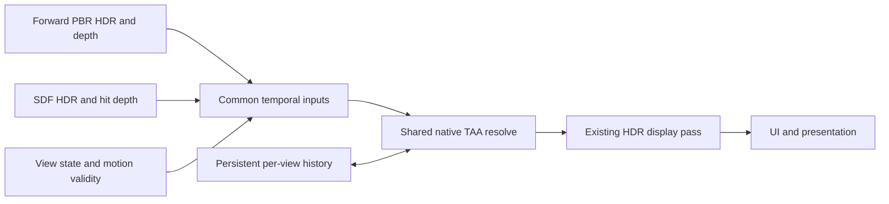

# Native TAA foundation plan

Date: 2026-11-17. Status: implemented opt-in; see the
[results and limits](taa-foundation-closeout.md). This retained contract is based
on `211903e8`. TAA first and shared foundation ownership are user requirements;
the showcase, consumer order and targets below record the implementation plan.

Build native-resolution temporal antialiasing as a reusable `cubey::render`
feature. Prove it through the forward PBR renderer and the independent SDF
renderer. Use the approved hill observatory as the main visual showcase and
the PBR material workshop for controlled surface comparisons. Completion needs
both producers using the same resolve, explicit history ownership and matched
motion evidence. A working shader in one application is an intermediate gate.

## Showcase and consumer order

Expected benefits below are hypotheses from the current render paths and
content. Establish moving AA-off baselines before claiming an improvement.

| Consumer | Expected value | Integration boundary | Proposed order |
| --- | --- | --- | --- |
| SDF authored scenes | Stabilize thin railings, roof trim, steps, curved silhouettes and small cutaway details; compare native TAA with the existing SS2 presentation cost. | Already produces linear HDR and actual hit depth, followed by `HdrPostFrame`. Static completed geometry permits camera-motion reconstruction. | Main showcase and required second renderer. |
| PBR material workshop | Controlled geometry, procedural pattern/bump detail and bright opaque materials; edits expose stale-history errors. | Uses `ForwardPbrRenderer3D`, sampled depth and shared postprocessing. | First real consumer and calibration surface. |
| glTF Viewer | Broad asset benefit: silhouettes, texture/normal detail and motion stability. | Shares forward PBR. Rigid motion, skin/morph deformation, alpha and transmission need different levels of input support. | First subsequent adoption: a deliberately admitted static opaque asset, then separate animation work. |
| Terrain | Stable distant edges and surface detail under camera movement. | Has its own HDR/depth/post graph; terrain placement/LOD and composite consumers need validity rules. | Later static-terrain adapter. |
| Ocean | Potentially large benefit for specular and distant surface instability. | Displaced waves, persistent foam, clipmap changes and moving reflected lighting require more than camera-only vectors. | Later dedicated motion/appearance experiment. |
| Terrain Water and Fluid | Possible surface-edge and detail improvements. | Changing wet/dry regions, surface geometry and volume/emission appearance need producer-specific temporal data. Rendering history must not affect solver state. | Separate later decisions. |
| Ray tracing | Opaque geometry is a possible adapter; glass is a difficult stress case. | No shared primary depth/MV output. Its accumulation and diagnostic alpha have separate semantics. | Parked for this milestone; no dragon repair or sampled-mode changes. |
| Atmosphere/clouds and 2D diagnostics | Selective benefit rather than universal need. | Clouds already have a separate diagnostic history; numerical and raw debug outputs must retain their meaning. | No automatic rollout. |

The observatory is a good foundation demonstration because it exercises a
different image producer from mesh rasterization, uses approved original content
and needs no downloaded model. Its intact and section views expose different
occlusion patterns. The [approved poster](../../site/public/media/csg-observatory.webp)
and [section](../../site/public/media/csg-observatory-section.webp) identify the
subjects; still images do not establish temporal aliasing.

Keep the model, field resolution, Balanced tracing, materials, lighting and camera
path fixed. Use new comparison presets rather than editing the approved roster:

| Comparison | Sampling | Question |
| --- | --- | --- |
| Off | SS1 | What instability exists at native resolution? |
| TAA | SS1 | Does temporal reconstruction improve it without unacceptable blur or trails? |
| Spatial reference | Existing Off + SS2 | What detail/cost tradeoff does native TAA offer? |

SS2 samples four times as many scene pixels; it is a spatial reference, not
optical ground truth or an equal-work comparison. TAA cannot restore geometry
missing from the SDF cache. If the visible defect is a cache/tracing limitation,
report it separately instead of tuning TAA or changing the model to conceal it.
Keep the saved construction replay outside the primary comparison: geometry
commits/seeks need explicit history invalidation.

## Foundation ownership

Follow the existing [renderer boundaries](../architecture/renderer-foundation.md)
and [reference-first workflow](../architecture/rendering-feature-workflow.md).

| Owner | Responsibility |
| --- | --- |
| `cubey::render` | Temporal input vocabulary, jitter/projection helpers, reusable motion reconstruction, TAA resolve/shader, persistent history resources, graph declarations, reset diagnostics and GPU qualification fixtures. |
| `cubey::engine` | Forward-renderer integration, per-view policy, opaque/rigid producer admission and previous-transform publication. |
| SDF project | Supply its camera, hit depth and content generation to the common feature; place the pass in its graph. No second blend/history implementation. |
| Scene/asset layers | Continue owning current scene/asset data. Do not add TAA policy or GPU history to importers or retain scene read guards across frames. |
| Host/GPU runtime | Keep submission, frame-slot retirement and presentation ownership. Use existing submission tickets; add only a narrow completion/invalidation seam if needed. |
| `HdrPostFrame` | Consume the selected resolved HDR image and retain the existing display transform. Do not hide temporal history inside the display pass. |
| Applications | Expose Off/TAA selection, supported presets and capture controls through their existing typed configuration. |

Candidate implementation locations are `include/cubey/render/temporal_aa.h`,
`src/cubey/render/temporal_aa.cpp` and a shared GLSL compute shader. Names and
function signatures settle during the first contract gate. Do not introduce a
generic upscaler/plugin framework for a single implemented feature.

## Input and history contract

| Input/state | Proposed semantics |
| --- | --- |
| Color | Scene-referred linear HDR before the final exposure/tone-map pass. Declare any pre-exposure explicitly. |
| Extents | Separate render and display dimensions in the vocabulary; V1 requires 1:1 native resolution. |
| Depth | Current sampled depth aligned with jittered color; explicit depth range, near/far and background convention. Existing forward-Z is supported. |
| Motion | Current pixel to its previous-frame position, in render pixels, top-left origin; RG16F production with FP32 diagnostic controls. Geometric motion excludes projection jitter. |
| View | Stable view identity, current/previous unjittered transforms, current/previous pixel jitter and actual submitted-frame sequence. |
| Validity | Explicit discontinuities and content/target generations. Unknown motion is not silently treated as static geometry. |
| History | Owned by one feature runtime per view, imported into the current graph with actual read/write state and last-use retirement. |

Color alpha keeps its producer-defined meaning; it is not implicitly a history
validity or reactivity mask. Check sampled/storage format support when the
feature is requested and fail that selection clearly without changing the
capability requirements of AA-off applications.

Use one centered 16-phase Halton(2,3) candidate for V1; replay recorded donor
inputs for parity rather than assuming its default jitter settings match.
Jitter affects scene geometry and the matching sky/ray generation, not UI,
shadow-map sampling, stable scene identity or ordinary camera culling.
Apply a conservative subpixel culling margin where necessary.

Static geometry still needs camera-motion vectors. A shared depth-reprojection
path supplies these for both forward and SDF. Sky uses rotation-only motion.
Rigid moving meshes additionally need previous object transforms, indexed by
stable entity/mesh generation rather than draw-list position. Retain bounded
transform values after a frame is accepted, not entire scene snapshots. New or
replaced objects invalidate their correspondence. Previous skin/morph vertices
and procedural surface motion remain later producer contracts.

For V1, generate camera motion from depth in a shared fullscreen/compute step.
Overlay rigid-mover vectors in an opt-in depth-matched velocity pass using
current coverage and current/previous unjittered transforms. This avoids adding
velocity output to every existing beauty shader. Missing correspondence must
reject history for the affected pixels; zero motion is not an invalid marker.
Test coverage/depth agreement and include both steps in the cost budget.

The existing SDF projection uses near/far `0.01/100`; its fragment shader writes
matching hit depth and clears misses to 1. Verify that relationship with known
world points. Do not apply another consumer's projection constants to it.

History follows consecutive submitted views, independently of CPU frame slots
and swapchain images. The cloud history's per-slot chronology is not a template
for TAA. A render attempt that never submits must not become the previous image;
invalidate uncertain history on recording/submission failure. One ordered queue
and explicit inter-frame image dependencies are sufficient for V1.

Reset on first use, cuts, incompatible projection/extent/format changes,
renderer-mode changes, scene replacement, topology/field commits, seek/restart
and discontinuous material edits. Ordinary camera movement, rigid motion and
changing jitter do not reset history. Post-only exposure edits preserve
scene-referred history. Frozen clear lighting is the initial admitted environment;
continuously evolving clouds/appearance need a later quality decision.

## Algorithm and admission

Start from the explicitly MIT-licensed public Donut TAA core at pinned commit
`52efbe37d7f550ea1c5c7ee02b75404ec7c72c09`. The runnable Linux sample
from NVIDIA's DLSS `v310.9.16` release remains comparison evidence only. Its bundled
shader has no MIT notice and companion files are proprietary; the original donor
description was corrected during implementation. The verified archive SHA-256 is
`985019f1307c0367d0d4dff35f06b2615c5c3ad6b469ffec5b0c16e28758610d`.
The donor's PQ-domain history, neighborhood variance clamp, history sampling and
blend form the first parity target. Do not mix Filament's filters or add sharpening
while proving the port. A bounded donor-only shader/fixture toolchain is allowed
for qualification; normal Cubey builds retain GLSL/glslang and gain no DLSS,
Donut/NVRHI or DXC requirement.

Current [Donut TAA](https://github.com/NVIDIA-RTX/Donut/blob/52efbe37d7f550ea1c5c7ee02b75404ec7c72c09/shaders/passes/taa_cs.hlsl)
differs from the bundled source. Its newer optional features are not included in
the already-run sample evidence. [Filament's design](https://github.com/google/filament/blob/ac7ac4f306494dd1c7acb37e8607798289b0b02e/filament/src/materials/antiAliasing/taa/taa.md)
is a secondary reference for reprojection, rejection and finite HDR behavior.
If the faithful donor fails the agreed motion/disocclusion gates, select one
bounded, source-justified refinement or revise the scope; do not keep tuning
against an expanding scene list.

V1 admits opaque rigid meshes and completed static opaque SDF scenes, with camera
motion and clear sky. A small controlled moving rigid object is required for
foundation qualification even though the main SDF scene is static. Transparent,
alpha-masked/blended, deformed, volumetric and dynamically displaced producers
remain explicitly unqualified; opt-in TAA must not claim support for them.
Choose new presets that satisfy admission and report an unsupported selection
before altering a live scene. Existing AA-off paths retain their behavior.

Initial controls expose Off/TAA rather than a filter-tuning panel. Raw semantic,
depth, normal and numerical diagnostics use the unjittered AA-off path, with
requested/effective mode and bypass reason recorded. The first SDF TAA presets
explicitly use SS1; TAA+SS2 is outside V1 admission. Existing SS2 presets stay
unchanged. No new default or replacement public media is part of initial rollout.
An application that never selects TAA allocates no TAA history/motion targets and
records no temporal passes. Turning TAA off stops jitter and uses the original
image path; retire any previously used resources after their real GPU use ends.

## Implementation gates

| Gate | Deliverable and stop condition |
| --- | --- |
| P0 Baselines and contract | Pin current source, binary, shaders, scene and donor inputs. Record SS1/SS2 observatory motion and opaque workshop controls. Confirm a visible sampling problem and freeze motion, quality measurements and tolerances before porting. If this subject has no useful problem, use another approved CSG view or an admitted opaque glTF subject without changing the foundation scope. |
| P1 Isolated shared core | Prove jitter, depth reconstruction and known camera/object motion against analytic controls. Run donor and GLSL resolve on identical input/history/jitter fixtures. Establish finite HDR and first-frame behavior before engine integration. |
| P2 Forward consumer | Integrate through `ForwardPbrRenderer3D` and the opaque PBR workshop. Exercise static camera, moving camera, one rigid mover, material edits and sky. Camera-only vectors cannot pass the moving-object gate. |
| P3 SDF consumer and showcase | Reuse the same core for completed observatory/intact-section views. Validate hit-depth reconstruction, no field rebuild on TAA-only changes, content-generation resets and SS1/SS2 comparison. Both image producers must work before claiming foundation completion. |
| P4 Lifecycle and integration | Qualify one/two/three frame slots, independent views, resize, cuts, toggles, seek/reset, failed creation/recording, retry and GPU-retired teardown. Run relevant existing runtime, shader/header/layer, documentation and synchronization gates, then the full dev suite. |
| P5 Visual/cost decision | Deliver matched stills, real-time motion, convergence/reset diagnostics, serial GPU costs and memory accounting. Review stability together with detail and ghosting. Default promotion and public-site publication remain separate decisions. |

The planned source change areas are shared render/shader code and its tests,
forward-renderer integration, narrow PBR/SDF configuration/adapters, new
comparison presets and evidence/docs. DLSS SDK setup and device-extension
generalization are deferred until a DLSS integration is selected.

## Acceptance packet

Use a generated opaque calibration fixture with diagonal/thin edges, depth
layers, a bright HDR patch, one moving rigid object and clear background. Use
opaque workshop materials such as clay, woven cloth, wood and bronze to inspect
edge stability, pattern detail and bright response. Their actual benefit is
measured rather than assumed from their names.

At 1920x1080, replay identical stationary, slow-pan, orbit/stop/return and cut
sequences. Include hold frames at history ages 0, 1, 2, 4, 8, 16, 32 and 64,
subpixel/fast movement and a disocclusion reveal. Keep source, camera, lighting,
display transform, shader policy and AA-independent settings matched. Repeat
only the camera/geometry changes intended by each control.

Numeric controls cover zero geometric motion at rest despite jitter, known
signed motion in both axes, world-point depth reconstruction, out-of-bounds and
invalid previous positions, finite/nonnegative resolved HDR, independent views
and no stale image after reset. Check FP32 motion against a double-precision
oracle; bound RG16F error by its quantization rather than imposing an impossible
constant error at large velocities. Freeze fixture tolerances in P0.

Report temporal instability only on correctly reprojected valid regions or
against matching reference poses; ordinary image differences include real
motion. Show the same full views and detail crops for Off, TAA and SS2, so a
lower variance caused by blur cannot pass alone. Inspect railings, steps, dome
slit, interior edges, procedural patterns and trails after the moving object.
Human visual review is required for the final sharpness/ghosting tradeoff.

Headless motion advances one TAA update per submitted frame with a deterministic
pose sequence. A settled still may freeze world time while jitter/history
advance; record its warmup count. Do not converge each movie frame independently
and present it as interactive TAA. Native windowed recordings run at normal wall
clock speed; record rendered frame counts and any encoding repeats separately.

Measure motion production, resolve and complete-scene GPU p50/p95 serially after
warmup, without validation or video encoding. Proposed review target: combined
motion/resolve p95 at or below 1.5 ms at 1080p on the RTX 5070 Ti. This is a
budget proposal, not a measured result. Compare total SS1+TAA and SS2 costs on
the chosen SDF views. Report requested texture/buffer bytes, allocator/device
estimates and host capture cost separately; do not infer whole-process peak VRAM.

AA-off compatibility, layer/header/shader checks, Vulkan synchronization,
resource failure/retry, source-pinned native captures, physical desktop behavior
and human visual acceptance remain distinct evidence. Existing content and
qualified inputs are preserved. Disabling TAA selects the original path without
history sampling or jitter; rejected TAA work can remain an opt-in study.

## Deferred work and source audit

No DLAA/DLSS implementation, temporal upscaling, dynamic resolution, sharpening,
frame generation, ray reconstruction, denoising, optical repair, solver changes,
automatic fleet of project adapters or new showcase website is included.
Keep future-compatible input semantics without building those systems now.

The [source audit](../evidence/taa-foundation-planning-2026-11/source-audit.json)
pins the reviewed files and consumer facts. The earlier Linux donor captures,
source downloads and research findings are retained under
`/home/bryan/code/cubey/outputs/aa/research-20261117/`; they establish a runnable
reference, not implementation of this plan. The main and RT checkouts, parked
horse study, approved scenes, original presets, caches and native evidence stay
outside the planning change.
