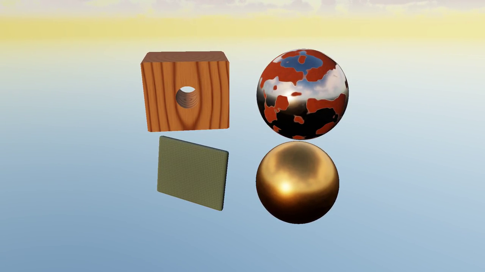

# PBR material workshop

Ordinary mesh spheres, a beveled block, an oriented swatch and a bored block use `ForwardPbrRenderer3D` with the
twelve standalone recipes in [`assets/materials`](../../assets/materials).
The [reviewed plan](../../docs/notes/pbr-material-demo-plan.md) and
[SDF workshop contract](../../docs/notes/sdf-material-workshop-plan.md) define scope.

## Presentation

The [public material showcase](https://dev.byebyebryan.com/cubey/demos/materials/)
puts all twelve spheres in one view, with moving clouds and matching forward
PBR / SDF dusk and dawn films. Run either forward preset:

```sh
build/release/projects/pbr_materials/pbr_materials --config projects/pbr_materials/presets/presentation/library-dusk.json
build/release/projects/pbr_materials/pbr_materials --config projects/pbr_materials/presets/presentation/library-dawn.json
```

See the [matched native presentation guide](presets/presentation/README.md) for
camera, lighting, recipe coordinates and optical limits.

### Frozen four-specimen study

[](../../docs/media/material-workshops/pbr.mp4)

Wood, rusted steel, woven cloth and bronze share one frozen low-sun environment
while an eased camera arc reveals their different surfaces. Watch the
[presentation and inspectable SDF cut](http://starship:8787/reports/5ddba21d5b0e6a6e2ff2a88ccb788cce0a4e2c0527ea8c5bc89b4a0c0bf8d71e/)
or run the preset:

```sh
build/release/projects/pbr_materials/pbr_materials --config projects/pbr_materials/presets/presentation/contrast.json
```

Controls start collapsed; expand the title bar for pause/replay and the full
material workshop. Space pauses, R restarts, and drag/scroll still orbit/zoom.
`--presentation-time 4` selects a reproducible snapshot. The alternative
`surfaces.json` preset retains the frosted-glass group audition. The
[media package](../../docs/media/material-workshops/README.md) retains both
1080p masters and 720p clips with capture provenance.

## Workshop

```sh
cmake --build build/release --target cubey_project_pbr_materials
build/release/projects/pbr_materials/pbr_materials
build/release/projects/pbr_materials/pbr_materials --material marble --lighting clouds
build/release/projects/pbr_materials/pbr_materials --headless --material clay --specimen block --output outputs/clay.png
build/release/projects/pbr_materials/pbr_materials --material wood --specimen cut-block
build/release/projects/pbr_materials/pbr_materials --material woven-cloth --specimen swatch
build/release/projects/pbr_materials/pbr_materials --material frosted-glass --lighting clouds
```

Select a recipe to inspect and edit it; drag/scroll to orbit/zoom. Pattern and
bump toggles, component views, reset and recipe save/reload provide bounded
experiments. Colors are linear. `--recipe-input` and `--recipe-output` operate on
resolved standalone recipes. `--roughness`, `--pattern-scale`, `--yaw`, `--pitch`
and `--orbit-degrees` support repeatable captures. Lighting is `studio` (default,
no atmosphere/cloud allocation), `clear`, or frozen `clouds` using the accepted
shared low-sun settings. No terrain or ground plane is introduced.

Glass uses the existing forward volume/refraction route with a thickness estimate
for the selected specimen: 0.5 units for sphere/block, 0.036 for the swatch and
0.32 for the bored block. The SDF adapter measures in-medium distances instead. V1
shared glass remains plain neutral, roughness 0.05, with editable IOR and
attenuation. It does not introduce a new transport solver.

Live edits use one preallocated opt-in material table per retired frame slot.
Each holds one permanent handle per catalog entry; selecting opaque/glass switches
handles. Routing changes within a handle are rejected before publication.
`--stress-edits 1000` exercises each used slot without growing UBO or descriptor
residency. Existing imported materials remain immutable by default. Family
filtering and the four-column gallery scale selection beyond the original seven.
Library reload validates the complete candidate; roster/order/optical-route
changes require restart to preserve permanent handles.

The [library expansion evidence](../../docs/notes/material-library-evidence.md)
covers wood, rusted steel, kraft cardboard, woven cloth and frosted glass in both
consumers. Twelve-material mesh gallery costs are 0.452 ms in studio and 2.089 ms
with clouds on the qualified 1080p RTX 5070 Ti run. These are bounded GPU scene
measurements; setup and encoding are separate. Recipe V2 and resolved SDF scene
V3 preserve new parameters through save/reload. V1 content remains unchanged.

[Original seven-material qualification and review report](../../docs/notes/material-workshops-evidence.md):
98 images, five eight-second films, retained control images/fingerprints,
shared recipe round trips, native editing checks and measured 1080p costs.
The seven-material mesh gallery measures 0.303 ms in studio and 2.607 ms with
clouds on the qualified RTX 5070 Ti run; setup and encoding are separate.
New visual presentation remains open to user review.

Reproduce the bounded native matrix with
`python3 projects/pbr_materials/tools/qualify_workshops.py --stage all`.
The report builder is `projects/pbr_materials/tools/build_workshops_report.py`;
its compatibility/diagnostic inputs are documented in the evidence record.

The expansion uses `projects/pbr_materials/tools/qualify_library.py` and
`build_library_report.py` in the same directory. The new qualification discovers
the shared catalog and retains native command, binary, shader and recipe receipts.
